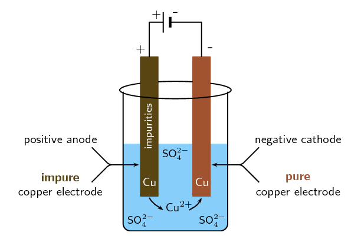
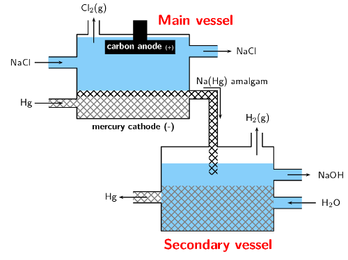
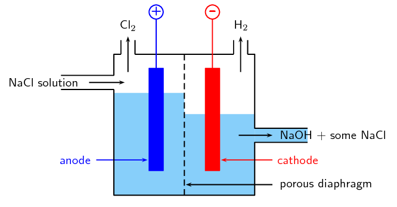
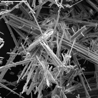
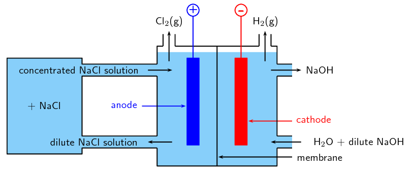
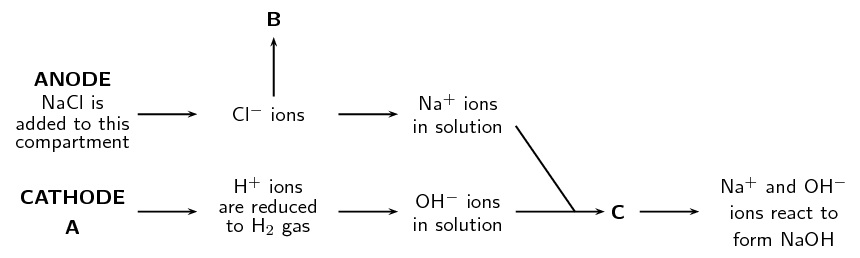
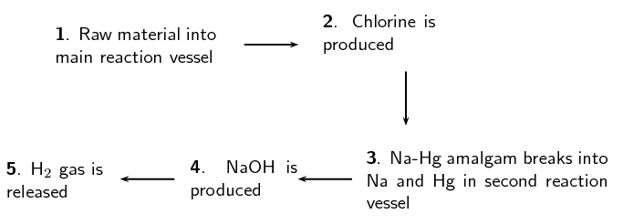
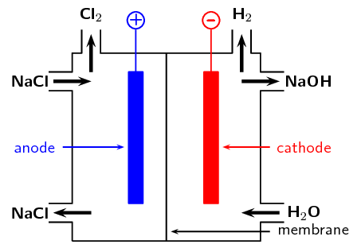
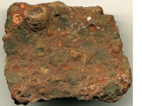

## 13.7 Applications of electrochemistry (ESCRP)

Electrochemistry has a number of different uses, particularly in industry. The principles of cells are
                  used to make **electrical batteries**. In science and technology, a battery is a device
                  that stores chemical energy and makes it available in an electrical form. Batteries are made of
                  electrochemical devices such as one or more galvanic cells or fuel cells. Batteries have many uses
                  including in:

<Callout type="note" title="Note">
A **fuel cell** converts the chemical potential energy produced by the oxidation of
                        fuels (e.g. hydrogen gas, hydrocarbons, alcohols) into electrical energy.

</Callout>

- torches
- electrical appliances such as cellphones (long-life alkaline batteries)
- digital cameras (lithium batteries)
- hearing aids (silver-oxide batteries)
- digital watches (mercury/silver-oxide batteries)
- military applications (thermal batteries)

In this section we are going to look at a few examples of the uses of electrochemistry in industry.

### Electroplating (ESCRQ)

The electrolytic cell can be used for **electroplating**.

Electroplating

The process of coating an electrically conductive object with a thin layer of metal
                                    using an electrical current.

Electroplating occurs when an electrically conductive object is coated with a layer of metal using
                        electrical current. Sometimes, electroplating is used to give a metal particular properties or
                        for aesthetic reasons:

- corrosion protection
- abrasion and wear resistance
- the production of jewellery

**a)** An electroplated piece of aluminium artwork and **b)**
                                    a wax stool electroplated in copper.

Electro-refining (also sometimes called **electrowinning**) is electroplating on a
                        large scale. Copper plays a major role in the electrical industry as it is very conductive and
                        is used in electric cables. One of the problems though is that copper must be pure if it is to
                        be an effective current carrier. One of the methods used to purify copper, is electrowinning
                        (copper ore is processed into impure *blister copper*, which is then deposited as pure
                        copper through electroplating). The copper electrowinning process is as follows:

2. A bar of \(\color{copperone}{\textbf{impure}}\) copper containing other metallic
                                       impurities acts as the \(\color{blue}{\textbf{anode}}\).
4. The \(\color{red}{\textbf{cathode}}\) is made up of
                                       \(\color{coppertwo}{\textbf{pure}}\) copper with few impurities.
6. The electrolyte is a solution of aqueous \(\text{CuSO}_{4}\) and
                                       \(\text{H}_{2}\text{SO}_{4}\).
   
   Figure 13.12: A simplified diagram to illustrate what happens during the
                                                   electrowinning of copper.
8. When current passes through the cell, electrolysis takes place:
   - The \(\color{copperone}{\textbf{impure copper anode}}\) oxidises to form
                                                     \(\text{Cu}^{2+}\) ions in solution. The \(\color{blue}{\textbf{anode
                                                     decreases in mass}}\).
     \(\color{copperone}{\textbf{Cu(s)}} \to\) \(\text{Cu}^{2+}(\text{aq}) +
                                                     2\text{e}^{-}\)
   - At the cathode reduction of positive copper ions takes place to produce
                                                     \(\color{coppertwo}{\textbf{pure copper metal}}\). The
                                                     \(\color{red}{\textbf{cathode}}\) \(\color{red}{\textbf{increases in
                                                     mass}}\).
     \(\text{Cu}^{2+}(\text{aq}) + 2\text{e}^{-}\) \(\to
                                                     \color{coppertwo}{\textbf{Cu(s)}}\) (\(>\)99% purity)
10. The other metal impurities do not dissolve (\(\text{Au}(\text{s})\),
                                       \(\text{Ag}(\text{s})\)) and form a solid sludge at the bottom of the tank or remain
                                       in solution (\(\text{Zn}(\text{aq})\), \(\text{Fe}(\text{aq})\) and
                                       \(\text{Pb}(\text{aq})\)) in the electrolyte.

<QuizCard id="s12-13-07a" title="Interactive Exercise 13.14" question="Define the term electrolysis ." options=["electrical energy", "thermal energy", "chemical energy", "an electrolyte", "entropy", "thermal energy", "electrical energy", "chemical energy", "A", "B", "C", "D", "A", "B", "C", "D", "a stronger reducing agent", "a stronger oxidising agent", "a weaker reducing agent", "lower on the reduction table", "form ions", "be reduced", "be oxidised", "reduce"] answer="0, 0" hint="" explanation="Define the term electrolysis Electrolysis is the chemical process in which electrical energy is converted to chemical energy . Submit your answer as: electrical energy and chemical energy" />

### The chloralkali industry (ESCRR)

The chlorine-alkali (chloralkali) industry is an important part of the chemical industry, which
                        produces **chlorine** and **sodium hydroxide** through the
                        electrolysis of the raw material **brine**. Brine is a saturated solution of sodium
                        chloride (\(\text{NaCl}\)) that is obtained from natural salt deposits.

Brine

A saturated aqueous solution of sodium chloride.

<Callout type="note" title="Note">
Remember that electrolytic cells are used to transform reactants into products by turning
                              electric current into chemical potential energy.
</Callout>

The products of the chloralkali industry have a number of important uses:

**Chlorine** is used:

- to purify water
- as a disinfectant
- in the production of:
  - hypochlorous acid (used to kill bacteria in drinking water)
  - paper, food
  - antiseptics, insecticides, medicines, textiles, laboratory chemicals
  - paints, petroleum products, solvents, plastics (such as polyvinyl chloride)

**Sodium hydroxide** (also known as 'caustic soda') is used to:

- make soap and other cleaning agents
- purify bauxite (the ore of aluminium)
- make paper
- make rayon (artificial silk)

One of the problems of producing chlorine and sodium hydroxide is that when they are produced
                        together the chlorine combines with the sodium hydroxide to form chlorate (\(\text{ClO}^{-}\))
                        and chloride (\(\text{Cl}^{-}\)) ions. This leads to the production of sodium chlorate,
                        \(\text{NaClO}\), a component of household bleach.

To overcome this problem the chlorine and sodium hydroxide must be separated from each other so
                        that they don't react. There are three industrial processes that have been designed to overcome
                        this problem. All three methods involve **electrolytic cells**.

2. **The Mercury Cell**
   In the mercury-cell (Figure 13.13):
   - The anode is a carbon electrode suspended from the top of a chamber.
   - The cathode is liquid mercury that flows along the floor of this chamber.
   - The electrolyte is brine (\(\text{NaCl}\) solution) that is passed through
                                                     the chamber.
   - When an electric current is applied to the circuit, chloride ions in the
                                                     electrolyte are \(\color{blue}{\text{oxidised at the anode}}\) to form
                                                     chlorine gas.
     \(\color{blue}{\text{2Cl}^{-}\text{(aq)} \to \text{Cl}_{2}
                                                     \text{(g) + 2e}^{-}}\)
   - At the same time sodium ions are \(\color{red}{\text{reduced at the
                                                     anode}}\) to solid sodium. The solid sodium dissolves in the mercury
                                                     making a sodium/mercury amalgam.
     \(\color{red}{\text{Na}^{+}\text{(aq) + Hg(ℓ) + e}^{-} \to
                                                     \text{Na(Hg)}}\)
   - The amalgam is poured into a separate vessel, where it decomposes into
                                                     sodium and mercury.
   - The sodium reacts with water in the vessel and produces sodium hydroxide
                                                     and hydrogen gas, while the mercury returns to the electrolytic cell to
                                                     be used again.
     \(\color{red}{\text{2Na(Hg) + 2H}_{2}\text{O(ℓ)} \to
                                                     \text{2NaOH(aq) + H}_{2}\text{(g) + Hg(ℓ)}}\)
   
   Figure 13.13: The mercury cell.
   <Callout type="note" title="Note">
   In a mercury cell the sodium dissolves in the liquid mercury to form a liquid
                                             amalgam of the two metals. This separates the \(\text{Cl}^{-}\) and
                                             \(\text{Na}^{+}\) ions.
   </Callout>
    
The following animation gives a good demonstration of how a mercury cell works.

    

                                       
<a
                                                   href="http://www.eurochlor.org/the-chlorine-universe/how-is-chlorine-produced/the-mercury-cell-process/mercury-cell-process.aspx">Video:
                                                   2836</a>

                                 

   This method only produces a fraction of the chlorine and sodium hydroxide that is used
                                       by industry as it has certain disadvantages:
   - mercury is expensive and toxic
   - some mercury always escapes with the brine that has been used
   - mercury reacts with the brine to form mercury(II) chloride
   - the mercury cell requires a lot of electricity
   - although the chlorine gas produced is very pure, mercury has to be removed
                                                     from the sodium hydroxide and hydrogen gas mixture.
   In the past the effluent was released into lakes and rivers, causing mercury to
                                       accumulate in fish and other animals feeding on the fish. Today, the brine is
                                       treated before it is discharged so that the environmental impact is lower.
4. **The Diaphragm Cell**
   In the diaphragm-cell (Figure
                                             13.14):
   - a porous diaphragm divides the electrolytic cell into an anode compartment
                                                     and a cathode compartment
   - brine is introduced into the anode compartment and flows through the
                                                     diaphragm into the cathode compartment
   - an electric current is passed through the brine causing the salt's chlorine
                                                     ions and sodium ions to move to the electrodes
   - Chlorine gas is produced at the \(\color{blue}{\text{anode}}\)
     \(\color{blue}{\text{2Cl}^{-}\text{(aq) + 2e}^{-} \to
                                                     \text{Cl}_{2}\text{(g)}}\)
   - At the \(\color{red}{\text{cathode}}\), sodium ions react with water
                                                     forming caustic soda (\(\text{NaOH}\)) and hydrogen gas.
     \(\color{red}{\text{2Na}^{+}\text{(aq) + 2H}_{2}\text{O(ℓ) + e}^{-}
                                                     \to
                                                     \text{2NaOH(aq) + H}_{2}\text{(g)}}\)
   - Some \(\text{NaCl}\) salt remains in the solution with the caustic soda and
                                                     can be removed at a later stage.
   
   Figure 13.14: The diaphragm cell.
    
The following animation gives a good demonstration of how a diaphragm cell works.

    

                                       
<a
                                                   href="http://www.eurochlor.org/the-chlorine-universe/how-is-chlorine-produced/the-diaphragm-cell-process/diaphragm-process.aspx">Video:
                                                   2837</a>

                                 

   The advantages of the diaphragm cell are:
   - uses less energy than the mercury cell
   - does not contain toxic mercury
   It also has disadvantages however:
   - the sodium hydroxide is much less concentrated and not as pure
   - the chlorine gas often contains oxygen gas as well
   - the process is less cost-effective as the sodium hydroxide solution needs
                                                     to be concentrated and purified before it can be used
   <Callout type="note" title="Note">
   To separate the chlorine from the sodium hydroxide, the two half-cells were
                                             traditionally separated by a porous asbestos diaphragm, which needed to be
                                             replaced every two months.
   
   This was damaging to the environment, as large quantities of asbestos had to be
                                             disposed. Asbestos is toxic to humans, and causes cancer and lung problems.
                                             Today, the asbestos is being replaced by other polymers, which do not need to
                                             be replaced as often, and are not toxic.
   </Callout>
6. **The Membrane Cell**
   The membrane cell (Figure 13.15)
                                       is very similar to the diaphragm cell, and the same reactions occur. The main
                                       differences are:
   - the two electrodes are separated by an ion-selective membrane, rather than
                                                     by a diaphragm
   - the membrane structure allows cations to pass through it between
                                                     compartments of the cell but does not allow anions to pass through (this
                                                     has nothing to do with the size of the pores, but rather with the
                                                     **charge on the ions**)
   - brine is pumped into the anode compartment, and only the
                                                     \(\color{red}{\text{positively charged}}\) \(\color{red}{\text{sodium
                                                     ions}}\) pass into the cathode compartment, which contains pure water
   
   Figure 13.15: The membrane cell.
    
The following animation gives a good demonstration of how a membrane cell works.

    

                                       
<a
                                                   href="http://www.eurochlor.org/the-chlorine-universe/how-is-chlorine-produced/the-membrane-cell-process/membrane-process.aspx">Video:
                                                   2838</a>

                                 

   - At the \(\color{blue}{\textbf{positively charged anode}}\),
                                                     \(\text{Cl}^{-}\) ions from the brine are oxidised to \(\text{Cl}_{2}\)
                                                     gas.
     \(\color{blue}{\text{2Cl}^{-}\text{(aq)} \to
                                                     \text{Cl}_{2}\text{(g) + 2e}^{-}}\)
   - At the \(\color{red}{\textbf{negatively charged cathode}}\), water
                                                     molecules are reduced to hydrogen gas and hydroxide ions.
     \(\color{red}{\text{2H}_{2}\text{O(ℓ) + 2e}^{-} \to
                                                     \text{H}_{2}\text{(g) + 2OH}^{-}}\)
   - The \(\text{Na}^{+}\) ions flow through the membrane to the cathode
                                                     compartment and react with the remaining hydroxide (\(\text{OH}^{-}\))
                                                     ions from the water to form sodium hydroxide (\(\text{NaOH}\)).
     \(\color{red}{\text{Na}^{+}\text{(aq) + OH}^{-}\text{(aq)} \to
                                                     \text{NaOH(aq)}}\)
   - The chloride ions cannot pass through the membrane, so the chlorine does
                                                     not come into contact with the sodium hydroxide in the cathode
                                                     compartment. The sodium hydroxide is removed from the cell. The overall
                                                     equation is as follows:
     \(2\text{NaCl}(\text{aq}) + 2\text{H}_{2}\text{O}(\text{ℓ})\) \(\to\)
                                                     \(\text{Cl}_{2}(\text{g}) + \text{H}_{2}(\text{g}) +
                                                     2\text{NaOH}(\text{aq})\)
   The advantages of using this method are:
   - the sodium hydroxide that is produced is very pure because it is kept
                                                     separate from the sodium chloride solution
   - the sodium hydroxide has a relatively high concentration
   - this process uses the least electricity of all three cells
   - the cell is cheaper to operate than the other two cells
   - the cell does not contain toxic mercury or asbestos

<QuizCard id="s12-13-07b" title="Interactive Exercise 13.15" question="Give the chemical formula for the substance represented by C on the diagram. ( C is formed during the reaction at the cathode.)" options=["A", "B", "C"] answer="
						['OH^{-}', 'OH^{-}(aq)']
					" hint="You need to write a chemical compound here. A chemical compound can be any of the                following: Element: simply type in the element symbol as it appears on the periodic table. Chemical formula: just write the numbers showing the ratios of atoms normally. For example, water (H 2 O) is written as: H2O Ion: Use the exponent symbol ( ^ ) to represent a superscript. For example, the sodium ion (Na + ) is written as: Na^+ and the sulfate ion (SO 4 2− ) is written as: SO4^2− Electron: An electron is represented using e^- Compound formula: use round brackets around a compound ion in a formula. For example, calcium permanganate (Ca(MnO 4 ) 2 ) is written as: Ca(MnO4)2" explanation="Identify substance C In a membrane cell, brine (water and sodium chloride) is pumped into the anode compartment. The cathode compartment contains water and dilute sodium hydroxide. At the positively charged anode, chloride ions are oxidised to chlorine gas. At the negatively charged cathode water molecules are reduced to hydrogen gas and hydroxide ions. Therefore letter C represents OH − ions. (We want the ions formed by the reaction at the cathode.) Submit your answer as:" />

<QuizCard id="s12-13-07b" title="Interactive Exercise 13.15" question="The following table compares two types of cell used in the chlor-alkali industry. Fill in the missing words in the columns for the Membrane cell and the Mercury cell ." options=["sodium hydroxide", "brine", "carbon dioxide", "hydrogen gas", "hydrogen gas", "water", "chlorine gas", "coal", "reduced", "oxidised", "low", "medium", "high", "low", "medium", "high"] answer="1, 0, 0, 2, 2" hint="" explanation="Fill in the table comparing the two cells Membrane cell Mercury cell Main raw material brine brine Mechanism of seperating chlorine and sodium hydroxide membrane (ion-selective) two chambers Cathode reaction water is reduced to form hydrogen gas sodium ions are reduced to sodium Anode reaction chloride ions are oxidised to chlorine gas chloride ions are oxidised to chlorine gas Purity of sodium hydroxide high purity low purity Energy consumption low energy use high energy use Environmental impact very low amounts of waste produces toxic mercury waste Submit your answer as: brine and hydrogen gas and reduced and high and high" />

## The chloralkali industry

### Textbook Exercise 13.10

Refer to the flow diagram, which shows the reactions that take place in the
                                                membrane cell, and then answer the questions that follow.

**Problem:**
What liquid is present in the cathode compartment at
                                                      **A**?

**Solution:**
Water and dilute \(\text{NaOH}\)

**Problem:**
Identify the gas that is produced at **B**.

**Solution:**
Chlorine gas

**Problem:**
Explain one feature of this cell that allows the \(\text{Na}^{+}\)
                                                      and \(\text{OH}^{-}\) ions to react at **C**.

**Solution:**
This type of cell has an ion permeable membrane that allows the
                                                      positive \(\text{Na}^{+}\) ions to move from the anode compartment
                                                      to the cathode compartment and interact with the \(\text{OH}^{-}\)
                                                      ions.

**Problem:**
Give a balanced equation for the reaction that takes place at
                                                      **C**.

**Solution:**
\(\text{Na}^{+}(\text{aq}) + \text{OH}^{-}(\text{aq})\) \(\to\)
                                                      \(\text{NaOH}(\text{aq})\)

**Problem:**
Summarise what you have learnt about the three types of cells in the
                                                chloralkali industry by completing the table below:

|  | Mercury cell | Diaphragm cell | Membrane cell |
| --- | --- | --- | --- |
| Main raw material |  |  |  |
| Mechanism of separating \(\text{Cl}_{2}\) and \(\text{NaOH}\) |  |  |  |
| Anode reaction |  |  |  |
| Cathode reaction |  |  |  |
| Purity of NaOH produced |  |  |  |
| Purity of \(\text{Cl}_{2}\) produced |  |  |  |
| Energy consumption |  |  |  |
| Environmental impact |  |  |  |
| Cost of production |  |  |  |

**Solution:**
|  | Mercury cell | Diaphragm cell | Membrane cell |
| --- | --- | --- | --- |
| Main raw material | brine | brine | brine |
| Mechanism of separating \(\text{Cl}_{2}\) and \(\text{NaOH}\) | reduction of \(\text{Na}^{+}\) to \(\text{Na}\) in \(\text{Hg}\) amalgam | use of a porous diaphragm | use of a membrane (charge specific) |
| Anode reaction | \(\text{Cl}^{-}\) ions \(\to\) \(\text{Cl}_{2}\) gas | \(\text{Cl}^{-}\) ions \(\to\) \(\text{Cl}_{2}\) gas | \(\text{Cl}^{-}\) ions \(\to\) \(\text{Cl}_{2}\) gas |
| Cathode reaction | \(\text{Na}^{+}\) ions \(\to\) \(2\text{Na}(\text{Hg})\) \(2\text{Na}(\text{Hg}) +
                                                                  2\text{H}_{2}\text{O}(\text{ℓ})\) \(\to\)
                                                                  \(2\text{NaOH}(\text{aq}) + \text{H}_{2}(\text{g})\) | \(2\text{Na}^{+}(\text{aq}) +
                                                                  \text{H}_{2}\text{O}(\text{ℓ})\) \(\to\)
                                                                  \(2\text{NaOH}(\text{ℓ}) +
                                                                  \text{H}_{2}(\text{g})\) | \(2\text{Na}^{+}(\text{aq}) +
                                                                  \text{H}_{2}\text{O}(\text{ℓ})\) \(\to\)
                                                                  \(2\text{NaOH}(\text{ℓ}) +
                                                                  \text{H}_{2}(\text{g})\) |
| Purity of NaOH | low purity | medium purity low concentration | high purity |
| Purity of \(\text{Cl}_{2}\) | high purity | mixed with \(\text{O}_{2}\) | mixed with \(\text{O}_{2}\) |
| Energy consumption | high | less than the mercury cell | low energy |
| Environmental impact | high | lower than the mercury cell | lower than the diaphragm and mercury cell |
| Cost of production | expensive | expensive, as product must be purified | low production cost |

The diagram below shows the sequence of steps that take place in the
                                                mercury cell.

**Problem:**
Name the 'raw material' in step **1**.

**Solution:**
Aqueous sodium chloride (\(\text{NaCl}\), brine)

**Problem:**
Give the chemical equation for the reaction that produces chlorine
                                                      gas in step 2.

**Solution:**
\(2\text{Cl}^{-}(\text{aq})\) \(\to\) \(\text{Cl}_{2}(\text{g}) +
                                                      2\text{e}^{-}\)

**Problem:**
What other product is formed in step 2.

**Solution:**
sodium mercury amalgam

**Problem:**
Name the reactants in step 4.

**Solution:**
sodium mercury amalgam and water

Approximately \(\text{30}\) million tonnes of chlorine are used throughout
                                                the world annually. Chlorine is produced industrially by the
                                                electrolysis of brine. The diagram represents a membrane cell used in
                                                the production of \(\text{Cl}_{2}\) gas.

**Problem:**
What ions are present in the electrolyte in the left hand compartment
                                                      of the cell?

**Solution:**
Chloride ions (\(\text{Cl}^{-}\)) and sodium ions
                                                      (\(\text{Na}^{+}\)).

**Problem:**
Give the equation for the reaction that takes place at the anode.

**Solution:**
\(2\text{Cl}^{-}(\text{aq})\) \(\to\) \(\text{Cl}_{2}(\text{g}) +
                                                      2\text{e}^{-}\)

**Problem:**
Give the equation for the reaction that takes place at the cathode
                                                      and forms a gas.

**Solution:**
\(2\text{H}_{2}\text{O}(\text{ℓ}) + 2\text{e}^{-}\) \(\to\)
                                                      \(\text{H}_{2}(\text{g}) + 2\text{OH}^{-}(\text{aq})\)

**Problem:**
What ion passes through the membrane while these reactions are taking
                                                      place?

**Solution:**
Sodium ions

**Problem:**
Chlorine is used to purify drinking water and swimming pool water.
                                                      The substance responsible for this process is the weak acid,
                                                      hypochlorous acid (\(\text{HOCl}\)). One way of putting
                                                      \(\text{HOCl}\) into a pool is to bubble chlorine gas through the
                                                      water. Give an equation showing how bubbling
                                                      \(\text{Cl}_{2}(\text{g})\) through water produces
                                                      \(\text{HOCl}\).

**Solution:**
\(\text{Cl}_{2}(\text{g}) + \text{H}_{2}\text{O}(\text{ℓ})\)
                                                      \(\to\)
                                                      \(\text{HOCl}(\text{aq}) + \text{HCl}(\text{aq})\)

**Problem:**
A common way of treating pool water is by adding 'granular chlorine'.
                                                      Granular chlorine consists of the salt calcium hypochlorite,
                                                      \(\text{Ca}(\text{OCl})_{2}\). Give an equation showing how this
                                                      salt dissolves in water. Indicate the phase of each substance in
                                                      the equation.

(IEB Paper 2, 2003)

**Solution:**
\(\text{Ca}(\text{OCl})_{2}(\text{s})\) \(\to\)
                                                      \(\text{Ca}^{2+}(\text{aq}) + 2\text{OCl}^{-}(\text{aq})\)

### The extraction of aluminium (ESCRS)

Aluminium is a commonly used metal in industry, where its properties of being both light and strong
                        can be utilised. It is used in the manufacture of products such as aeroplanes and motor cars.
                        The metal is present in deposits of bauxite. Bauxite is a mixture of silicas, iron oxides and
                        hydrated alumina (\(\text{Al}_{2}\text{O}_{3}\).x\(\text{H}_{2}\text{O}\)).

<Callout type="note" title="Note">
Bauxite is a rock that contains a large amount of aluminum oxide
                              (\(\text{Al}_{2}\text{O}_{3}\)) and aluminium hydroxide (\(\text{Al}(\text{OH})_{3}\)) as
                              well as many other aluminium containing minerals. Bauxite is the richest source of
                              aluminum when compared with any other common rock, and is the best aluminum ore.

</Callout>

Electrolysis can be used to extract aluminium from bauxite. The process described below produces
                        99% pure aluminium:

2. Aluminium is melted along with cryolite (\(\text{Na}_{3}\text{AlF}_{6}\)) which acts as
                                       the electrolyte. Cryolite helps to lower the melting point and dissolve the ore.
4. The \(\color{blue}{\text{carbon rod anode}}\) provides a site for the oxidation of
                                       \(\text{O}^{2-}\) and \(\text{F}^{-}\) ions. Oxygen and fluorine gas are given off
                                       at the anode and also result in anode consumption.
   \(\color{blue}{\text{2O}^{2-}\text{(aq)} \to \text{O}_{2}\text{(g) + 4e}^{-}}\)
   \(\color{blue}{\text{2F}^{-}\text{(aq)} \to \text{F}_{2}\text{(g) + 2e}^{-}}\)
6. At the \(\color{red}{\text{cathode cell lining}}\), the \(\text{Al}^{3+}\) ions are
                                       reduced and metal aluminium deposits on the lining.
   \(\color{red}{\text{Al}^{3+}\text{(aq) + 3e}^{-} \to \text{Al(s)}}\) (99% purity)
8. The \(\text{AlF}_{6}^{3-}\) electrolyte is stable and remains in its molten state.

The overall reaction is as follows:

\(2\text{Al}_{2}\text{O}_{3}(\text{s})\) \(\to\) \(4\text{Al}(\text{s}) + 3\text{O}_{2}(\text{g})\)

The only problem with this process is that the reaction is **endothermic** and large
                        amounts of electricity are needed to drive the reaction. The process is therefore very
                        expensive.

<QuizCard id="s12-13-07d" title="Interactive Exercise 13.17" question="Adapted from DBE Nov 2016 Grade 12, P2, Q9 Physical constants · Chemistry formulas · Periodic table · Standard reduction potentials In the electrochemical cell below, carbon electrodes are used during the electrolysis of a concentrated salt-water solution. The balanced equation for the net (overall) cell reaction is: 2H 2 O(ℓ) \(+\) 2Cl − (aq) \(\rightarrow\) \(\downarrow\) Cl 2 (g) \(+\) H 2 (g) \(+\) 2OH − (aq) Study the above cell and reaction and then answer the questions which follow. INSTRUCTIONS: Spelling counts! You do not need to give state symbols in any of your answers." options=["electrical to chemical", "chemical to electrical", "P", "Q", "negative", "positive", "decreases", "increases", "conc. NaCl(aq)", "H\u2083O\u207a ions", "hydroxide ions", "concentrated brine"] answer="0, 1, 1, ['chlorine', 'diatomic chlorine', 'chlorine gas', 'diatomic chlorine gas', 'chlorine molecules', 'elemental chlorine', 'diatomic chlorine gas molecules'], ['H_{2}', 'H_{2}(g)'], ['2Cl^{-} \\rightarrow Cl_{2} + 2e^{-}', '2Cl^{-}(aq) \\rightarrow Cl_{2}(g) + 2e^{-}', '2Cl^{-} \\rightarrow Cl_{2} + 2e', '2Cl^{-}(aq) \\rightarrow Cl_{2}(g) + 2e'], 1, 0" hint="" explanation="Think about how energy is involved in the electrolysis of brine The electrolysis of brine (salt-water or a sodium chloride solution) requires an external power source in order to cause and maintain a chemical change. 1. The energy conversion in the electrochemical cell is electrical to chemical . Identify which half-reaction takes place at each electrode Electrode Q is connected to the positive terminal of the cell and Electrode P is connected to the negative terminal of the cell. This means that electrons will leave Electrode Q and flow into Electrode P through the external circuit when everything is connected. In other words, electrons are lost at Electrode Q and electrons are gained at Electrode P . So oxidation takes place at Electrode Q (making it the anode ) and reduction takes place at Electrode P (making it the cathode ). TIP: You can use the following to help you remember the basics about electrochemical cells! OIL RIG ( O xidation I s L oss , R eduction I s G ain ) An Ox - Ox idation at the An ode Red Cat - Red uction at the Cat hode 2. Oxidation takes place at Electrode Q . This is because it is connected to the positive terminal of the battery. General summary on the electrolysis of brine The oxidation half-reaction takes place at at Electrode Q , the anode . 2Cl − (aq) \(\rightarrow\) \(\downarrow\) Cl 2 (g) \(+\) 2e − So Gas Y is chlorine , Cl 2 (g) . The reduction half-reaction takes place at at Electrode P , the cathode . 2H 2 O(ℓ) \(+\) 2e − \(\rightarrow\) \(\downarrow\) H 2 (g) \(+\) 2OH − (aq) So Gas X is hydrogen , H 2 (g) . We have all we need to answer the questions we were asked: 3. The name of Gas Y is chlorine . 4. The formula of Gas X is H 2 . 5. The half-reaction that takes place at the anode is: 2Cl − \(\rightarrow\) \(\downarrow\) Cl 2 \(+\) 2e − Think about the products that form during the reaction The balanced net reaction (including the spectator Na + ion) for the electrolysis of brine is: 2H 2 O(ℓ) \(+\) 2NaCl(aq) \(\rightarrow\) \(\downarrow\) Cl 2 (g) \(+\) H 2 (g) \(+\) 2 NaOH (aq) The last product is sodium hydroxide , NaOH . It is a strong base (containing hydroxide ions ) and its common name is caustic soda . 6. During the course of the reaction, the \(\text{pH}\) of the solution in the cell increases . This is due to the formation of hydroxide ions . Submit your answer as: electrical to chemical and Q and positive and and and and increases and hydroxide ions" />
