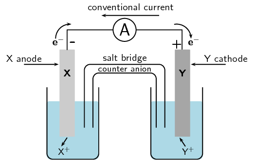
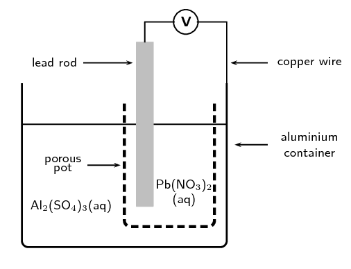
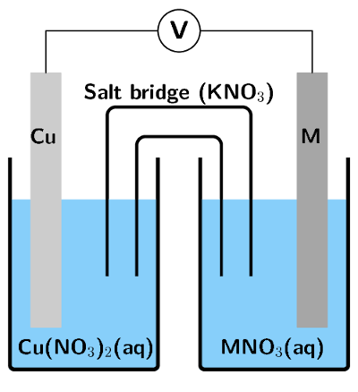

## 13.8 Chapter summary (ESCRT)

[Presentation: 283F](http://www.slideshare.net/slideshow/embed_code/34471903)

- **Oxidation** is the loss of electrons and **reduction** is
                                          the gain of electrons.
- A **redox reaction** is one where there is always a change in the
                                          oxidation numbers of the elements that are involved in the reaction.
- It is possible to **balance** redox equations using the half-reactions
                                          that take place within the overall reaction.
- An **electrochemical reaction** is one where either a chemical reaction
                                          produces an electric current, or where an electric current causes a chemical
                                          reaction to take place.
- In a **galvanic cell** a chemical reaction produces a current in the
                                          external circuit. An example is the zinc-copper cell.
- An **electrolytic cell** is an electrochemical cell that uses
                                          electricity to drive a non-spontaneous reaction. In an electrolytic cell,
                                          **electrolysis** occurs, which is a process of separating elements
                                          and compounds using an electric current.
- Cells have a number of **components**. They consist of two
                                          **electrodes**, which are connected to each other by an external
                                          circuit wire.
- In a **galvanic** cell each electrode is placed in a separate container
                                          in an **electrolyte** solution. The two electrolytes are connected
                                          by a **salt bridge**.
- In an **electrolytic** cell both electrodes are placed in the same
                                          container in an **electrolyte** solution.
- One of the electrodes is the **anode**, where **oxidation**
                                          takes place. The **cathode** is the electrode where
                                          **reduction** takes place.
- In a galvanic cell, the build up of electrons at the anode sets up a potential
                                          difference between the two electrodes, and this causes a
                                          **current** to flow in the external circuit.
- Standard cell notation for a galvanic cell has the anode on the left and the cathode
                                          on the right. For example:
  \(\text{Zn}(\text{s})|\text{Zn}^{2+}(\text{aq})||\text{Cu}^{2+}(\text{aq})|\text{Cu}(\text{s})\)
  \(|\) = a phase boundary (solid/aqueous)
  \(||\) = the salt bridge
- Different metals have different **reaction potentials**. The reduction
                                          potential of metals (in other words, their ability to ionise), is recorded in a
                                          **table of standard electrode reduction potentials**. The more
                                          negative the value, the greater the tendency of the metal to be oxidised. The
                                          more positive the value, the greater the tendency of the metal to be reduced.
- The values on the table of standard electrode potentials are measured relative to the
                                          **standard hydrogen electrode**.
- The EMF of a cell can be calculated using one of the following equations:
  E°(cell) = E°(reduction half-reaction) - E°(oxidation half-reaction)
  E°(cell) = E°(oxidising agent) - E°(reducing agent)
  E°(cell) = E°(cathode) - E°(anode)
- It is possible to predict whether a reaction is **spontaneous** or not,
                                          either by looking at the sign of the cell EMF or by comparing the electrode
                                          potentials of the two half-cells.
- Industrial applications of cells include electrolysis (the electrowinning of copper),
                                          in the chloralkali industry (**mercury**,
                                          **diaphragm** and **membrane** cells), as well as the
                                          extraction of metals from ores (e.g. aluminium from bauxite).

**A comparison of galvanic and electrolytic cells**

It should be much clearer now that there are a number of differences between *galvanic* and
                        *electrolytic* cells. Some of these differences have been summarised in Table 13.5.

|  | Galvanic cell | Electrolytic cell |
| --- | --- | --- |
| Chemical reactions | spontaneous reactions | non-spontaneous reactions |
| Energy changes | Chemical potential energy from chemical reactions is converted to electrical energy | An external supply of electrical energy causes a chemical reaction to occur |
| Anode | is negative , oxidation occurs at anode | is positive , oxidation occurs at anode |
| Cathode | is positive , reduction occurs at cathode | is negative , reduction occurs at cathode |
| Cell set-up | two half-cells, one electrode in each, connected by a salt-bridge | one cell, both electrodes in cell, no salt-bridge |
| Electrolyte solution(s) | The electrolyte solutions are kept separate from one another, and are connected by a salt bridge | The cathode and anode are in the same electrolyte |
| Applications | batteries | Electrolysis e.g. of water, NaCl, electroplating |

Table 13.5: A comparison of galvanic and electrolytic cells.

<QuizCard id="s12-13-08a" title="Interactive Exercise 13.18" question="Adapted from DBE Nov 2015 Grade 11, P2, Q9 Physical constants \(·\) Chemistry formulas \(·\) Periodic table \(·\) Standard reduction potentials In the reaction below, a reducing agent and an oxidising agent react with each other and a redox reaction takes place. Cu + (aq) \(\:+\:\) Fe 3+ (aq) \(\rightarrow\) \(\downarrow\) Cu 2+ (aq) \(\:+\:\) Fe 2+ (aq) Define the term reducing agent ." options=[] answer="
                    1
                " hint="" explanation="Define a reducing agent A reducing agent donates electrons to another substance which decreases the oxidation number of the other substance . The reducing agent is itself oxidised. The above definition means that the reducing agent causes another species to be reduced.                     This is why it is called the reducing agent! NOTE: In the given equation, Cu + (aq) loses an electron                     to form Cu 2+ (aq) . It is oxidised, so it is the                     reducing agent. Submit your answer as: donates electrons to another substance." />

<QuizCard id="s12-13-08a" title="Interactive Exercise 13.18" question="Physical constants \(·\) Chemistry formulas \(·\) Periodic table \(·\) Standard reduction potentials Working with oxidation numbers and thinking about electron transfer are essential when working with redox reactions. Using these concepts you can work out if a chemical species (atom or ion) is oxidised or reduced. Define the term reduced species ." options=[] answer="
                    0
                " hint="" explanation="Define reduction A species is reduced if its oxidation number decreases because it gains electrons . Submit your answer as: its oxidation number decreases." />

<QuizCard id="s12-13-08a" title="Interactive Exercise 13.18" question="Which one of the following statements about oxidation numbers is true ?" options=[] answer="
                    0
                " hint="" explanation="What is an oxidation number? The oxidation number (oxidation state) of an element in a substance is a number given to atoms of elements to keep track of how many electrons have been removed from or added to those atoms. The oxidation number can be: positive (electrons removed), negative (electrons gained), or zero (no transfer of electrons). Atoms of elements in both ionic and covalent compounds are assigned (given) oxidation numbers. For ionic compounds , the oxidation numbers are simply equal to the charges of the ions. For example: NaCl is an ionic compound made up of Na + and Cl − ions. The charge on the sodium ion is \(\text{+1}\) so it has an oxidation number of \(\text{+1}\) . The charge on the chloride ion is \(-\text{1}\) so it has an oxidation number of \(-\text{1}\) . For polar covalent compounds , you need to assume that electrons are fully transferred (and not shared) to form ions. Assume that the atom with the higher electronegativity gets all the electrons. The oxidation numbers are then equal to the charges on these imaginary ions. For example: H 2 O is a polar covalent compound made up of hydrogen and oxygen atoms. Oxygen has a higher electronegativity than hydrogen. So if we assume that the electrons are not shared, but fully transferred, then each hydrogen atom will give its electron to the oxygen atom. So each hydrogen atom will have an oxidation number of \(\text{+1}\) and the oxygen atom will have an oxidation number of \(-\text{2}\) (it gained two electrons in total). NOTE: The oxidation number is not a real charge, but a hypothetical (imagined) charge. The oxidation number is helpful to keep track of where the electrons are in a compound. Identify the true statement We can now work out which statement is true . I ✔ You can assign oxidation numbers to elements in ionic compounds. True II ✘ In polar covalent compounds you need to assume that electrons are shared perfectly between atoms. False In polar covalent compounds you need to assume that electrons are fully transferred from one atom to another. III ✘ The oxidation number is zero if a neutral atom has not lost or gained any protons. False The oxidation number is zero if a neutral atom has not lost or gained any electrons . IV ✘ The oxidation number is positive if a neutral atom has gained electrons. False The oxidation number is positive if a neutral atom has lost electrons . Statement I is true . Submit your answer as: I You can assign oxidation numbers to elements in ionic compounds." />

<QuizCard id="s12-13-08a" title="Interactive Exercise 13.18" question="Which one of the following is not a correct rule used to determine oxidation numbers?" options=[] answer="
                    3
                " hint="" explanation="Revise rules to calculate oxidation numbers Elements in monatomic gases or in molecules made up of only one element have an oxidation number of \(\text{0}\) . The oxidation number of a monatomic ion is equal to the charge of the ion. Group 1 metals usually have an oxidation number of \(\text{+1}\) . Group 2 metals usually have an oxidation number of \(\text{+2}\) . Halogens (Group 17) usually have an oxidation number of \(-\text{1}\) . Oxygen usually has an oxidation number of \(-\text{2}\) in a compound. Peroxides are an exception where O has an oxidation number of \(-\text{1}\) . Hydrogen usually has an oxidation number of \(\text{+1}\) in a compound. Metal hydrides are an exception where H has an oxidation number of \(-\text{1}\) . Compounds are neutral . The sum of the oxidation numbers of all the elements in a compound must be zero. Polyatomic ions have a charge. The sum of the oxidation numbers of all the elements in a polyatomic ion must be equal to the charge on the ion . Some elements (such as transition metals) have variable valency. The oxidation numbers of these elements depends on which substance they are in. These must be calculated using known oxidation numbers . Identify the statement that is not a rule I ✘ Polyatomic ions have a charge. The sum of the oxidation numbers of all the elements in a polyatomic ion must be equal to the charge on the ion. This is a rule. II ✘ Some elements (such as transition metals) have variable valency. The oxidation numbers of these elements depends on which substance they are in. These must be calculated using known oxidation numbers. This is a rule. III ✘ Compounds are neutral. The sum of the oxidation numbers of all the elements in a compound must be zero. This is a rule. IV ✔ Hydrogen usually has an oxidation number of \(-\text{1}\) in a compound. Metal hydrides are an exception where H has an oxidation number of \(\text{+1}\) . This is not a rule. Hydrogen usually has an oxidation number of \(\text{+1}\) in a compound. Metal hydrides are an exception where H has an oxidation number of \(-\text{1}\) . Statement IV is not a correct rule for determining oxidation numbers. Submit your answer as: IV Hydrogen usually has an oxidation number of \(-\text{1}\) in a compound. Metal hydrides are an exception where H has an oxidation number of \(\text{+1}\) ." />

<QuizCard id="s12-13-08a" title="Interactive Exercise 13.18" question="Identify the name of the reducing agent and the name of the oxidising agent. INSTRUCTION: Give the name , not the formula." options=[] answer="
                        ['barium', 'solid barium']
                    ,
                        ['iron(II)', 'aqueous iron(II)', 'iron(II) ion', 'aqueous iron(II) ion', 'iron', 'aqueous iron', 'iron ion', 'aqueous iron ion', 'iron(II) ions', 'aqueous iron(II) ions', 'aqueous iron ions', 'iron ions', 'iron(||)', 'iron(11)', 'iron(ll)', 'aqueous iron(||)', 'aqueous iron(11)', 'aqueous iron(ll)', 'iron(||) ion', 'iron(11) ion', 'iron(ll) ion', 'aqueous iron(||) ion', 'aqueous iron(11) ion', 'aqueous iron(ll) ion', 'iron(||) ions', 'iron(11) ions', 'iron(ll) ions', 'aqueous iron(||) ions', 'aqueous iron(11) ions', 'aqueous iron(ll) ions']
                    " hint="" explanation="Recall what you know about reducing and oxidising agents Remember that the oxidising agent is reduced in the reaction and the reducing agent is oxidised . So to identify which species is the oxidising agent and which is the                         reducing agent we need to determine which species is reduced and which species is oxidised in this reaction. To decide which species is reduced and which species is oxidised we need to determine the change in oxidation numbers for each species in the reaction. Determine the reducing and oxidising agents We find that barium has an oxidation number of \(\text{0}\) in the reactants                         and an oxidation number of \(\text{+2}\) in the products. Therefore the Ba is oxidised in the                         reaction. This is the reducing agent . We find that iron has an oxidation number of \(\text{+2}\) in the                         reactants and an oxidation number of \(\text{0}\) in the products. Therefore Fe 2+ is reduced in the reaction. This is the oxidising agent . Therefore the name of the reducing agent is barium and                         the name of the oxidising agent is iron(II) . Submit your answer as: and" />

<QuizCard id="s12-13-08a" title="Interactive Exercise 13.18" question="Complete the table comparing galvanic and electrolytic cells below. You may only use the following words: negative spontaneous non-spontaneous two half-cells batteries reduction separate oxidation electrical electrolysis chemical positive one cell same Galvanic cell Electrolytic cell Chemical reactions spontaneous reactions non-spontaneous reactions Energy changes chemical potential energy to 1. ____ energy electrical energy to chemical potential energy Anode has a negative charge, oxidation occurs at this electrode has a 2. ____ charge, 3. ____ occurs at this electrode Cathode has a 4. ____ charge, reduction at this electrode has a negative charge, 5. ____ at this electrode Cell set-up two half-cells, one electrode in each, connected by a salt bridge one cell, two electrodes, no salt bridge Electrolyte solution(s) separate electrolyte solutions connected by a salt bridge same electrolyte solution Applications batteries electrolysis" options=[] answer="
					electrical
				,
					positive
				,
					oxidation
				,
					positive
				,
					reduction
				" hint="" explanation="Galvanic cell Electrolytic cell Chemical reactions spontaneous reactions non-spontaneous reactions Energy changes Chemical potential energy to electrical energy Electrical energy to chemical potential energy Anode has a negative charge, oxidation occurs at this electrode has a positive charge, oxidation occurs at this electrode Cathode has a positive charge, reduction occurs at this electrode has a negative charge, reduction occurs at this electrode Cell set-up two half-cells, one electrode in each, connected by a salt bridge one cell, two electrodes, no salt bridge Electrolyte solution(s) Separate electrolyte solutions connected by a salt bridge Same electrolyte solution Applications batteries electrolysis Submit your answer as: and and and and" />

<QuizCard id="s12-13-08a" title="Interactive Exercise 13.18" question="Give the half-reaction that occurs at the cathode . INSTRUCTION: You must include state symbols in your answer." options=[] answer="
                        ['Fe^{2+}(aq)+2e^{-} \\rightarrow Fe(s)', 'Fe^{2+}(aq)+2e \\rightarrow Fe(s)']
                    " hint="Write a chemical equation here. You can use the following symbols to write equations: plus: + one-way arrow (→): −> (this is a minus and a greater than symbol) two-way arrow (⇌): <=> (this is a less than symbol, an equal symbol and a greater than symbol) Here are some examples of equations and how you should write them: Na + + Cl − → NaCl can be written as: Na^+  +  Cl^−  −>  NaCl CH 3 CO 2 H + H 2 O ⇌                CH 3 CO 2 − + H 3 O + can be written as: CH3CO2H  +  H2O  <=>  CH3CO2^-  +  H3O^+ State symbols can be added by writing the appropriate state in brackets. For example: Na + (aq) + Cl − (aq) → NaCl(aq) can be written as: Na^+ (aq)  +  Cl^− (aq)  −>  NaCl (aq) The chemical compounds in the equation should be written like this, for the different                types of compounds: Element: simply type in the element symbol as it appears on the periodic table. Chemical formula: just write the numbers showing the ratios of atoms normally. For example, water (H 2 O) is written as: H2O Ion: Use the exponent symbol ( ^ ) to represent a superscript. For example, the sodium ion (Na + ) is written as: Na^+ and the sulfate ion (SO 4 2− ) is written as: SO4^2− Electron: An electron is represented using e^- Compound formula: use round brackets around a compound ion in a formula. For example, calcium permanganate (Ca(MnO 4 ) 2 ) is written as: Ca(MnO4)2" explanation="Recall what you know about standard cell notation We write the anode (where oxidation takes place) on the left . We write the cathode (where reduction takes place) on the right . We use a double vertical line ( \(||\) ) to indicate the salt bridge. We use a single vertical line ( \(|\) ) to indicate a phase boundary in each half reaction. If the compounds in each half-reaction are in the same phase then we use a comma (,) to separate the reactants. Determine the reaction at the cathode We are interested in the reaction at the cathode , which is written on the right : Ba(s) \(\vert\) Ba 2+ (aq) \(\vert\) \(\vert\) Fe 2+ (aq) \(\color{red}{\vert}\) Fe(s) This can be written: Fe 2+ (aq) \(\rightarrow\) \(\downarrow\) Fe(s) We now need to check that the atoms are balanced and then we need to add electrons to ensure that the charges are balanced. Fe 2+ (aq) \(\:+\:\) \(\text{2}\) e − \(\rightarrow\) \(\downarrow\) Fe(s) Submit your answer as:" />

<QuizCard id="s12-13-08a" title="Interactive Exercise 13.18" question="Label the following sketch of an electrolytic cell." options=["A", "B", "C", "D", "E", "F", "A", "B", "C", "D", "E", "F", "A", "B", "C", "D", "E", "F", "A", "B", "C", "D", "E", "F", "A", "B", "C", "D", "E", "F", "A", "B", "C", "D", "E", "F"] answer="
					2
				,
					4
				,
					0
				,
					1
				,
					3
				,
					5
				" hint="" explanation="For an electrolytic cell we note the following information: The electrode connected to the positive terminal of the battery is positive . The metal atoms of the positive electrode are oxidised to form metal cations. Oxidation is loss at the anode (OLA), so the positive electrode is the anode . The electrode connected to the negative terminal of the battery is negative . The metal cations in solution are reduced at the negative terminal. Reduction is gain at the cathode (RED CAT), so the negative electrode is the cathode . Electrons flow from the anode, through the external wire, to the cathode. Conventional current is from the cathode, through the external wire, to the anode. We are given a diagram with the terminals of the battery labelled. So we must ensure that our labels have the anode connected to the positive terminal (the long line of the battery) and the cathode connected to negative terminal (short line of the battery). The correct answers are: Anode C Cathode E Direction of conventional current A Direction of electrons B Negative charge D Positive charge F The completed diagram is: Submit your answer as: C and E and A and B and D and F" />

<QuizCard id="s12-13-08a" title="Interactive Exercise 13.18" question="Define the term electrolysis ." options=["production of", "use of", "maximum", "increase in", "to produce a", "to use a", "to reduce a", "created by a", "A", "B", "C", "D", "A", "B", "C", "D", "weaker oxidising agents", "stronger oxidising agents", "higher on the reduction table", "stronger reducing agents", "form ions", "reduce", "be oxidised", "be reduced"] answer="0, 0" hint="" explanation="Define the term electrolysis Electrolysis is the use of electrical energy to produce a chemical change . Submit your answer as: use of and to produce a" />

### Textbook Exercise 13.11

A cell is set up. There is a negative charge on the anode.

**Problem:**
What type of cell is this?

**Solution:**
Galvanic cell

**Problem:**
What type of reaction is occurring at the cathode?

**Solution:**
Reduction

**Problem:**
Can the electrodes have the same reaction potential?

**Solution:**
No, a galvanic cell requires two electrodes with different
                                                                reaction potentials (different metals).

**Problem:**
Draw and label a diagram of this cell.

**Solution:**

For each of the following, say whether the statement is
                                                        **true** or **false**. If it is false,
                                                        re-write the statement correctly.

**Problem:**
The anode in an electrolytic cell has a negative charge.

**Solution:**
False. The anode in an electrolytic cell has a positive
                                                                charge.

**Problem:**
The reaction \(2\text{KClO}_{3}(\text{s})\) \(\to\)
                                                                \(2\text{KCl}(\text{s}) + 3\text{O}_{2}(\text{g})\) is
                                                                an example of a redox reaction.

**Solution:**
True

**Problem:**
Lead is a stronger oxidising agent than nickel.

**Solution:**
True

Sulfur dioxide gas can be prepared in the laboratory by heating a
                                                        mixture of copper turnings and concentrated sulfuric acid in a
                                                        suitable flask.

**Problem:**
Derive a balanced ionic equation for this reaction using the
                                                                half-reactions that take place.

**Solution:**
The reaction uses copper and concentrated sulfuric acid and
                                                                produces sulfur dioxide. Look for a suitable reaction on
                                                                the table of standard electrode potentials:

\(\text{SO}_{4}^{2-}(\text{aq}) + 4\text{H}^{+}(\text{aq}) +
                                                                2\text{e}^{-}\) \(\rightleftharpoons\)
                                                                \(\text{SO}_{2}(\text{g}) +
                                                                2\text{H}_{2}\text{O}(\text{ℓ})\) (E\(^{\circ}\)
                                                                =
                                                                \(\text{+0,17}\) \(\text{V}\))

\(\text{Cu}^{2+}(\text{aq}) + 2\text{e}^{-}\)
                                                                \(\rightleftharpoons\) \(\text{Cu}(\text{s})\)
                                                                (E\(^{\circ}\) = \(\text{+0,34}\) \(\text{V}\))

The reactants must be copper and concentrated sulfuric acid,
                                                                therefore:

Reduction half-reaction: \(\text{SO}_{4}^{2-}(\text{aq}) +
                                                                4\text{H}^{+}(\text{aq}) + 2\text{e}^{-}\) \(\to\)
                                                                \(\text{SO}_{2}(\text{g}) +
                                                                2\text{H}_{2}\text{O}(\text{ℓ})\)

Oxidation half-reaction: \(\text{Cu}(\text{s})\) \(\to\)
                                                                \(\text{Cu}^{2+}(\text{aq}) + 2\text{e}^{-}\)

Adding the two half-reactions together and cancelling out the
                                                                electrons (the charge balances) gives us:

\(\text{SO}_{4}^{2-}(\text{aq}) + 4\text{H}^{+}(\text{aq}) +
                                                                \text{Cu}(\text{s})\) \(\to\) \(\text{SO}_{2}(\text{g})
                                                                + 2\text{H}_{2}\text{O}(\text{ℓ}) +
                                                                \text{Cu}^{2+}(\text{aq})\)

**Problem:**
Give the E° value for the overall reaction.

**Solution:**
E°\(_\text{(cell)}\) = E°\(_\text{(reduction)}\) -
                                                                E°\(_\text{(oxidation)}\) = \(\text{0,17}\) -
                                                                \(\text{0,34}\) = \(-\text{0,17}\) \(\text{V}\)

**Problem:**
Explain why it is necessary to heat the reaction mixture.

**Solution:**
The EMF of the cell is negative, so the reaction is
                                                                non-spontaneous. Therefore, heat will be needed to make
                                                                the reaction happen.

(IEB Paper 2, 2002)

For each of the following questions, choose the **one
                                                                correct** answer.

**Problem:**
Which one of the following reactions is a redox reaction?

2. \(\text{HCl}(\text{aq}) +
                                                                                   \text{NaOH}(\text{aq})\) \(\to\)
                                                                                   \(\text{NaCl}(\text{aq}) +
                                                                                   \text{H}_{2}\text{O}(\text{ℓ})\)
4. \(\text{AgNO}_{3}(\text{s}) +
                                                                                   \text{NaI}(\text{s})\) \(\to\)
                                                                                   \(\text{AgI}(\text{s}) +
                                                                                   \text{NaNO}_{3}(\text{s})\)
6. \(2\text{FeCl}_{3}(\text{aq}) +
                                                                                   2\text{H}_{2}\text{O}(\text{ℓ})
                                                                                   +
                                                                                   \text{SO}_{2}(\text{aq})\) \(\to\)
                                                                                   \(\text{H}_{2}\text{SO}_{4}(\text{aq}) +
                                                                                   2\text{HCl}(\text{aq}) +
                                                                                   2\text{FeCl}_{2}(\text{aq})\)
8. \(\text{BaCl}_{2}(\text{s}) +
                                                                                   \text{MgSO}_{4}(\text{s})\) \(\to\)
                                                                                   \(\text{MgCl}_{2}(\text{s}) +
                                                                                   \text{BaSO}_{4}(\text{s})\)

(IEB Paper 2, 2003)

**Solution:**
Only (iii) has both oxidation and reduction occurring (i.e. a
                                                                change in the oxidation numbers).

**iii) ** \(2\text{FeCl}_{3}(\text{s}) +
                                                                2\text{H}_{2}\text{O}(\text{ℓ}) +
                                                                \text{SO}_{2}(\text{aq})\) \(\to\)
                                                                \(\text{H}_{2}\text{SO}_{4}(\text{aq}) + 2\text{HCl} +
                                                                2\text{FeCl}_{2}(\text{aq})\)

**Problem:**
Consider the reaction represented by the following equation:

\(\text{Br}_{2}(\text{ℓ}) +
                                                                2\text{I}^{-}(\text{aq})\)
                                                                \(\to\) \(2\text{Br}^{-}(\text{aq}) +
                                                                \text{I}_{2}(\text{s})\)

Which one of the following statements about this reaction is
                                                                correct?

2. bromine is oxidised
4. bromine acts as a reducing agent
6. the iodide ions are oxidised
8. iodine acts as a reducing agent

(IEB Paper 2, 2002)

**Solution:**
Bromine gains electrons (is reduced), therefore bromine acts
                                                                as a oxidising agent. Iodide loses electrons (is
                                                                oxidised), therefore iodide acts as a reducing agent. In
                                                                the reverse reaction iodine would gain electrons (be
                                                                reduced) and act as an oxidising agent.

**iii) ** the iodide ions are oxidised

**Problem:**
The following equations represent two hypothetical
                                                                half-reactions:

\(\text{X}_{2} + 2\text{e}^{-}\) \(\rightleftharpoons\)
                                                                \(2\text{X}^{-}\) (E\(^{\circ}\) = \(\text{+1,09}\)
                                                                \(\text{V}\))

and

\(\text{Y}^{+} + \text{e}^{-}\) \(\rightleftharpoons\)
                                                                \(\text{Y}\) (E\(^{\circ}\) = \(-\text{2,80}\)
                                                                \(\text{V}\))

Which one of the following substances from these
                                                                half-reactions has the greatest tendency to lose
                                                                electrons?

2. \(\text{X}^{-}\)
4. \(\text{X}_{2}\)
6. \(\text{Y}\)
8. \(\text{Y}^{+}\)

**Solution:**
Loss of electrons is oxidation. The larger, negative value
                                                                will be oxidised more easily. \(\text{Y}\) \(\to\)
                                                                \(\text{Y}^{+} + \text{e}^{-}\)

**iii) ** \(\text{Y}\)

**Problem:**
Which one of the following redox reactions will
                                                                **not** occur spontaneously at room
                                                                temperature?

2. \(\text{Mn}(\text{s}) +
                                                                                   \text{Cu}^{2+}(\text{aq})\) \(\to\)
                                                                                   \(\text{Mn}^{2+}(\text{aq}) +
                                                                                   \text{Cu}(\text{s})\)
4. \(\text{Fe}^{3+}(\text{aq}) +
                                                                                   3\text{NO}_{2}(\text{g}) +
                                                                                   3\text{H}_{2}\text{O}(\text{ℓ})\)
                                                                                   \(\to\) \(\text{Fe}(\text{s}) +
                                                                                   3\text{NO}_{3}^{-}(\text{aq}) +
                                                                                   6\text{H}^{+}(\text{aq})\)
6. \(\text{Zn}(\text{s}) +
                                                                                   \text{SO}_{4}^{2-}(\text{aq}) +
                                                                                   4\text{H}^{+}(\text{aq})\) \(\to\)
                                                                                   \(\text{Zn}^{2+}(\text{aq}) +
                                                                                   \text{SO}_{2}(\text{g}) +
                                                                                   2\text{H}_{2}\text{O}(\text{ℓ})\)
8. \(5\text{H}_{2}\text{S}(\text{g}) +
                                                                                   2\text{MnO}_{4}^{-}(\text{aq}) +
                                                                                   6\text{H}^{+}(\text{aq})\) \(\to\)
                                                                                   \(5\text{S}(\text{s}) +
                                                                                   2\text{Mn}^{2+}(\text{aq}) +
                                                                                   8\text{H}_{2}\text{O}(\text{ℓ})\)
   (DoE Exemplar Paper 2, 2008)

**Solution:**
E°\(_\text{(cell)}\) = E°\(_\text{(reduction)}\) -
                                                                E°\(_\text{(oxidation)}\)

E°\(_\text{(cell)}\) for (i) =
                                                                E°\(_\text{(copper)}\) -
                                                                E°\(_\text{(manganese)}\) = \(\text{0,34} -
                                                                (-\text{1,18}\)) = \(\text{+1,52}\) \(\text{V}\).

Therefore spontaneous.

E°\(_\text{(cell)}\) for (ii) =
                                                                E°\(_\text{(iron)}\) - E°
                                                                \(_\text{(nitrogen dioxide)}\) = (\(-\text{0,06}\)) -
                                                                \(\text{0,80}\) =
                                                                \(-\text{0,86}\) \(\text{V}\).

Therefore non-spontaneous.

E°\(_\text{(cell)}\) for (iii) =
                                                                E°\(_\text{(sulfate ion)}\) -
                                                                E°\(_\text{(zinc)}\) = \(\text{0,17} -
                                                                (-\text{0,76}\)) = \(\text{+0,93}\) \(\text{V}\).

Therefore spontaneous.

E°\(_\text{(cell)}\) for (iv) =
                                                                E°\(_\text{(permanganate ion)}\) -
                                                                E°\(_\text{(hydrogen sulfide)}\) = \(\text{1,51}
                                                                - \text{0,14}\) = \(\text{+1,37}\) \(\text{V}\).

Therefore spontaneous.

Correct: **ii) ** \(\text{Fe}^{3+}(\text{aq}) +
                                                                3\text{NO}_{2}(\text{g}) +
                                                                3\text{H}_{2}\text{O}(\text{ℓ})\) \(\to\)
                                                                \(\text{Fe}(\text{s}) + 3\text{NO}_{3}^{-}(\text{aq}) +
                                                                6\text{H}^{+}(\text{aq})\)

In order to investigate the rate at which a reaction proceeds, a
                                                        learner places a beaker containing concentrated nitric acid on a
                                                        sensitive balance. A few pieces of copper metal are dropped into
                                                        the nitric acid.

**Problem:**
Use the relevant half-reactions from the table of standard
                                                                electrode potentials to derive the balanced net ionic
                                                                equation for the reaction that takes place in the
                                                                beaker.

**Solution:**
The reaction has nitric acid as a reactant, nitrogen monoxide
                                                                will be a product. Find a suitable reaction on the table
                                                                of standard electrode potentials:

Reduction half-reaction: \(\text{NO}_{3}^{-}(\text{aq}) +
                                                                4\text{H}^{+}(\text{aq}) + 3\text{e}^{-}\) \(\to\)
                                                                \(\text{NO}(\text{g}) +
                                                                2\text{H}_{2}\text{O}(\text{ℓ})\)

The reaction has solid copper as a reactant, so this must be
                                                                the oxidation half-reaction:

Oxidation half-reaction: \(\text{Cu}(\text{s})\) \(\to\)
                                                                \(\text{Cu}^{2+}(\text{aq}) + 2\text{e}^{-}\)

We need to multipy the reduction half-reaction by 2 and the
                                                                oxidation half-reaction by 3 to balance the charge:

\(2\text{NO}_{3}^{-}(\text{aq}) + 8\text{H}^{+}(\text{aq}) +
                                                                6\text{e}^{-}\) \(\to\) \(2\text{NO}(\text{g}) +
                                                                4\text{H}_{2}\text{O}(\text{ℓ})\)

\(3\text{Cu}(\text{s})\) \(\to\) \(3\text{Cu}^{2+}(\text{aq})
                                                                + 6\text{e}^{-}\)

to get:

\(2\text{NO}_{3}^{-}(\text{aq}) + 8\text{H}^{+}(\text{aq}) +
                                                                3\text{Cu}(\text{s})\) \(\to\) \(2\text{NO}(\text{g}) +
                                                                4\text{H}_{2}\text{O}(\text{ℓ}) +
                                                                3\text{Cu}^{2+}(\text{aq})\)

**Problem:**
What chemical property of nitric acid is illustrated by this
                                                                reaction?

**Solution:**
Nitric acid is being reduced, and can act as an oxidising
                                                                agent.

**Problem:**
List three observations that this learner would make during
                                                                the investigation.

(IEB Paper 2, 2005)

**Solution:**
The learner would observe:

- a (brown) gas bubbling in the solution
- a colour change (the solution changing from
                                                                                  colourless to green)
- a mass change

The following reaction takes place in an electrochemical cell:

\(\text{Cu}(\text{s}) + 2\text{AgNO}_{3}(\text{aq})\) \(\to\)
                                                        \(\text{Cu}(\text{NO}_{3})_{2}(\text{aq}) +
                                                        2\text{Ag}(\text{s})\)

**Problem:**
Give an equation for the oxidation half-reaction.

**Solution:**
\(\text{Cu}(\text{s})\) \(\to\) \(\text{Cu}^{2+}(\text{aq}) +
                                                                2\text{e}^{-}\)

**Problem:**
Which metal is used as the anode?

**Solution:**
Oxidation is loss at the anode. Therefore copper is the
                                                                anode.

**Problem:**
Determine the EMF of the cell under standard conditions.

(IEB Paper 2, 2003)

**Solution:**
\(\text{Cu}^{2+}(\text{aq}) + 2\text{e}^{-}\)
                                                                \(\rightleftharpoons\) \(\text{Cu}(\text{s})\)
                                                                (E\(^{\circ}\) = \(\text{+0,34}\) \(\text{V}\))

\(\text{Ag}^{+}(\text{aq}) + \text{e}^{-}\)
                                                                \(\rightleftharpoons\) \(\text{Ag}(\text{s})\)
                                                                (E\(^{\circ}\) = \(\text{+0,80}\) \(\text{V}\))

E°\(_\text{(cell)}\) = E°\(_\text{(reduction)}\) -
                                                                E°\(_\text{(oxidation)}\)

E°\(_\text{(cell)}\) = E°\(_\text{(silver)}\) -
                                                                E°\(_\text{(copper)}\) = \(\text{0,80}\) -
                                                                \(\text{0,34}\) = \(\text{0,46}\) \(\text{V}\)

A galvanic cell is constructed by placing a lead rod in a porous pot
                                                        containing a solution of lead nitrate. The porous pot is then
                                                        placed in a large aluminium container filled with a solution of
                                                        aluminium sulfate. The lead rod is then connected to the
                                                        aluminium container by a copper wire and voltmeter as shown.

**Problem:**
Define the term *reduction*.

**Solution:**
Reduction is the gain of electrons by an element or ion.

Write balanced equations for the reactions that take place
                                                                at...

**Problem:**
the cathode

**Solution:**
Lead has a smaller, negative E°
                                                                        (\(-\text{0,13}\) \(\text{V}\)) than aluminium
                                                                        (\(-\text{1,66}\) \(\text{V}\)). Therefore lead
                                                                        is more likely to be reduced. Reduction is gain
                                                                        of electrons at the cathode.

\(\text{Pb}^{2+}(\text{aq}) + 2\text{e}^{-}\) \(\to\)
                                                                        \(\text{Pb}(\text{s})\)

**Problem:**
the anode

**Solution:**
Aluminium has a larger, negative E°
                                                                        (\(-\text{1,66}\) \(\text{V}\)) than lead
                                                                        (\(-\text{0,13}\) \(\text{V}\)). Therefore
                                                                        aluminium is more likely to be oxidised.
                                                                        Oxidation is loss of electrons at the anode.

\(\text{Al}(\text{s})\) \(\to\)
                                                                        \(\text{Al}^{3+}(\text{aq}) + 3\text{e}^{-}\)

**Problem:**
Write a balanced net ionic equation for the reaction which
                                                                takes place in this cell.

**Solution:**
Balance the charge by multiplying the reduction half-reaction
                                                                by \(\text{3}\), and the oxidation half-reaction by
                                                                \(\text{2}\):

\(3\text{Pb}^{2+}(\text{aq}) + 6\text{e}^{-}\) \(\to\)
                                                                \(3\text{Pb}(\text{s})\)

\(2\text{Al}(\text{s})\) \(\to\) \(2\text{Al}^{3+}(\text{aq})
                                                                + 6\text{e}^{-}\)

Therefore the overal equation is:

\(3\text{Pb}^{2+}(\text{aq}) + 2\text{Al}(\text{s})\) \(\to\)
                                                                \(3\text{Pb}(\text{s}) + 2\text{Al}^{3+}(\text{aq})\)

**Problem:**
In which direction do electrons flow in the copper wire?
                                                                (\(\text{Al}\) to \(\text{Pb}\) or \(\text{Pb}\) to
                                                                \(\text{Al}\))

**Solution:**
In a galvanic cell the anode is negative and the cathode is
                                                                positive. Therefore electrons flow from the anode to the
                                                                cathode. From \(\text{Al}\) to \(\text{Pb}\).

**Problem:**
What are the two functions of the porous pot?

**Solution:**
The porous pot allows the flow of ions while also keeping the
                                                                two solutions separate.

**Problem:**
Calculate the EMF of this cell under standard conditions.

(IEB Paper 2, 2005)

**Solution:**
E°\(_\text{(cell)}\) = E°\(_\text{(cathode)}\) -
                                                                E°\(_\text{(anode)}\)

E°\(_\text{(cell)}\) = E°\(_\text{(lead)}\) -
                                                                E°\(_\text{(aluminium)}\) = \(-\text{0,13} -
                                                                (-\text{1,66})\) = \(\text{+1,53}\) \(\text{V}\)

An electrochemical cell is made up of a copper electrode in contact
                                                        with a copper nitrate solution and an electrode made of an
                                                        unknown metal \(\text{M}\) in contact with a solution of
                                                        \(\text{MNO}_{3}\). A salt bridge containing a
                                                        \(\text{KNO}_{3}\) solution joins the two half-cells. A
                                                        voltmeter is connected across the electrodes. Under standard
                                                        conditions the reading on the voltmeter is \(\text{+0,46}\)
                                                        \(\text{V}\).

**Problem:**
Sketch the electrochemical cell.

**Solution:**

**Problem:**
Write down the standard conditions which apply to this
                                                                electrochemical cell.

**Solution:**
Pressure = \(\text{101,3}\) \(\text{kPa}\)

Concentration = \(\text{1}\) \(\text{mol·dm$^{-3}$}\)

Temperature = \(\text{298}\) \(\text{K}\)

**Problem:**
\(\text{Cu}(\text{s})\) \(\to\) \(\text{Cu}^{2+}(\text{aq}) +
                                                                2\text{e}^{-}\). Identify the metal \(\text{M}\). Show
                                                                calculations.

**Solution:**
E°\(_{\text{(cell)}} =\)E°\(_\text{(reduction)}\) -
                                                                E°\(_\text{(oxidation)}\)

\(\text{Cu}^{2+}(\text{aq}) + 2\text{e}^{-}\)
                                                                \(\rightleftharpoons\) \(\text{Cu}(\text{s})\)
                                                                (E\(^{\circ}\) = \(\text{+0,34}\) \(\text{V}\))

We know the EMF of the cell (that is the reading on the
                                                                voltmeter), we are also shown that the copper reaction
                                                                is the oxidation half-reaction.

\(\text{+0,46}\) = E°\(_\text{(reduction)}\) -
                                                                \(\text{0,34}\)

E°\(_\text{(reduction)}\) = \(\text{0,46}\) +
                                                                \(\text{0,34}\) = \(\text{+0,80}\) \(\text{V}\)

Now we look at the table of standard potentials to find the
                                                                unknown metal. The metal is silver (\(\text{Ag}\)).

Use the standard electrode potentials to write down equations
                                                                for the:

**Problem:**
anode half-reaction

**Solution:**
Oxidation is loss (of electrons) at the anode.
                                                                        Therefore:

\(\text{Cu}(\text{s})\) \(\to\)
                                                                        \(\text{Cu}^{2+}(\text{aq}) + 2\text{e}^{-}\)

**Problem:**
cathode half-reaction

**Solution:**
Reduction is gain (of electrons) at the cathode.
                                                                        Therefore:

\(\text{Ag}^{+}(\text{aq}) + \text{e}^{-}\) \(\to\)
                                                                        \(\text{Ag}(\text{s})\)

**Problem:**
overall cell reaction

**Solution:**
To balance the charge the reduction half-reaction
                                                                        (silver) needs to be multiplied by \(\text{2}\):

\(2\text{Ag}^{+}(\text{aq}) + 2\text{e}^{-}\) \(\to\)
                                                                        \(2\text{Ag}(\text{s})\)

Therefore:

\(\text{Cu}(\text{s}) + 2\text{Ag}^{+}(\text{aq})\)
                                                                        \(\to\) \(\text{Cu}^{2+}(\text{aq}) +
                                                                        2\text{Ag}(\text{s})\)

**Problem:**
What is the purpose of the salt bridge?

(IEB Paper 2, 2004)

**Solution:**
The salt bridge acts as a transfer medium that allows ions to
                                                                flow through without allowing the different solutions to
                                                                mix and react. It completes the circuit and maintains
                                                                the neutrality of the half-cell solutions.
