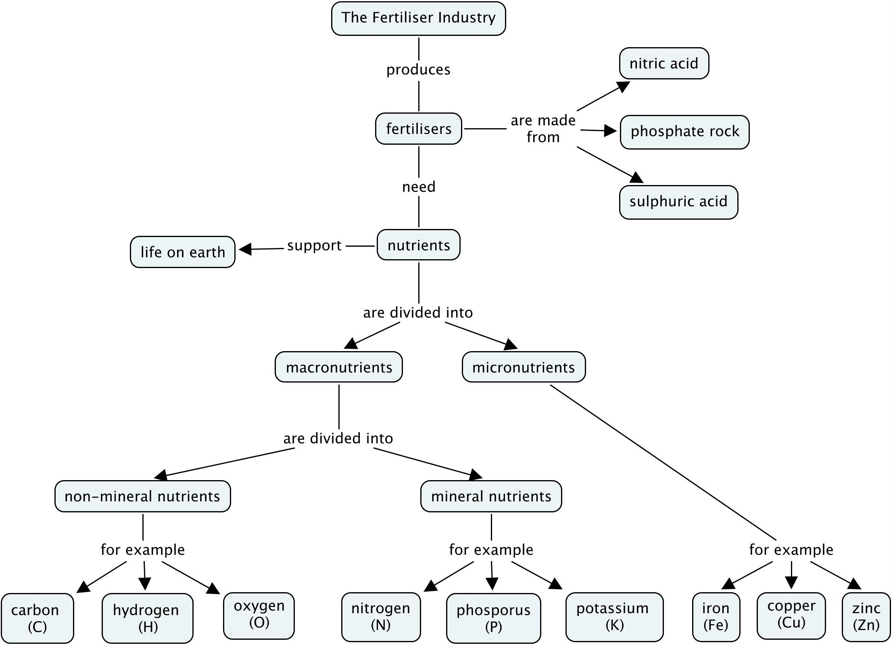
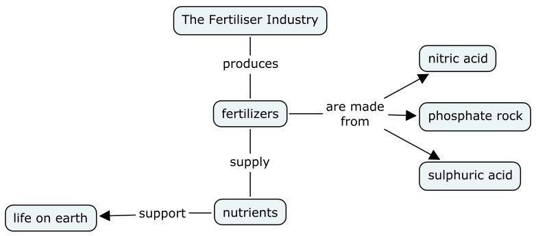

## 14.2 Nutrients (ESCRW)

### The importance of nutrients (ESCRX)

Nutrients are very important for life to exist. An **essential nutrient** is a
                        chemical that a plant needs to be able to grow from a seed and complete its life cycle, but that
                        it cannot produce itself. The same is true for animals. A **macronutrient** is a
                        chemical element that is required in *large quantities* by the plant or animal, whereas a
                        **micronutrient** is only needed in *small amounts* for a plant or an animal
                        to function properly.

Nutrient
A nutrient is a chemical substance used for the metabolism and the physiology of an organism
                              and is absorbed from the environment.

In plants, examples of *macronutrients* include carbon (\(\text{C}\)), hydrogen
                        (\(\text{H}\)), oxygen (\(\text{O}\)), nitrogen (\(\text{N}\)), phosphorus (\(\text{P}\)) and
                        potassium (\(\text{K}\)), while *micronutrients* include iron (\(\text{Fe}\)), chlorine
                        (\(\text{Cl}\)), copper (\(\text{Cu}\)) and zinc (\(\text{Zn}\)).

Nutrients that plants absorb **from the soil** are called *mineral nutrients*.
                        Mineral nutrients have to dissolve in the water in the soil before plants can absorb them.
                        **Non-mineral nutrients** are *not provided by the soil* itself, but from
                        the environment. For example oxygen and hydrogen can be obtained from rain water, while carbon,
                        in the form of carbon dioxide (\(\text{CO}_{2}\)) is obtained from the air. The source of each
                        of these nutrients for plants, and their function, is summarised in Table 14.1 (for
                        non-mineral nutrients) and Table 14.2 (for mineral nutrients).

<Callout type="note" title="Note">
The chemical elements mentioned in this chapter as nutrients really form part of larger
                              nutrient molecules such as proteins or amino acids, carbohydrates, fats, and vitamins.
</Callout>

| Non-mineral nutrients | Where the nutrient is found (source) | Why the nutrient is needed (function) |
| --- | --- | --- |
| Carbon (\(\text{C}\)) | Carbon dioxide in the air | Component of organic molecules such as carbohydrates, lipids and proteins |
| Hydrogen (\(\text{H}\)) | Water | Component of organic molecules |
| Oxygen (\(\text{O}\)) | Water | Component of organic molecules |

Table 14.1: The source and function of the non-mineral macronutrients in plants.

<Callout type="tip" title="Note">
*Blooming* refers to plants forming flowers. Phosphorus is particularly good for
                              flowering plants.
</Callout>

| Mineral nutrients | Where the nutrient is found (source) | Why the nutrient is needed (function) |
| --- | --- | --- |
| Nitrogen (\(\text{N}\)) | Nitrogen compounds in the soil | Part of plant proteins and chlorophyll, also boosts plant growth |
| Phosphorus (\(\text{P}\)) | Phosphate compounds in the soil | Needed for photosynthesis, blooming and root growth |
| Potassium (\(\text{K}\)) | Potassium compounds in the soil | Cell building, part of chlorophyll, and reduces diseases in plants |

Table 14.2: The source and function of the mineral macronutrients in plants.

Animals need similar nutrients in order to survive. However, since animals do not photosynthesise,
                        they rely on plants to supply them with the nutrients they need. Think of the human diet - we
                        cannot synthesise our own food and so we either need to eat vegetables, fruits and seeds (all of
                        which are direct plant products) or the meat of other animals which would have fed on plants. It
                        is important therefore that plants are always able to access the nutrients that they need so
                        that they will grow and provide food for other forms of life.

<QuizCard id="s12-14-02a" title="Interactive Exercise 14.1" question="Use the drop-down menus below to define macronutrients and micronutrients ." options=["chemical element", "vitamin", "organic molecule", "mineral or salt", "variable", "large", "small", "frequent", "the ecosystem", "the soil", "plants", "fertilisers", "large", "variable", "small", "infrequent", "Niacin", "Chlorine", "Riboflavin", "Oxygen", "micronutrient", "lipid", "macromolecule", "macronutrient", "the formation of volatile compounds", "the synthesis of many organic molecules", "flower petal formation", "strong bones and teeth"] answer="0, 0, 0, 0" hint="" explanation="Complete the statement about macronutrients and micronutrients The correct definition for macronutrients and micronutrients is: A micronutrient is a chemical element that is required in small quantities by plants . A macronutrient is required in large quantities. Submit your answer as: chemical element and small and plants and large" />

<QuizCard id="s12-14-02a" title="Interactive Exercise 14.1" question="Define a mineral nutrient ." options=["potassium (K)", "oxygen (O)", "sulfur (S)", "carbon (C)", "melt", "solidify", "dissolve", "liquify", "plant leaves", "water in the soil", "cell membranes", "air", "oxides", "ions", "halides", "channels", "the environment", "the sun", "the oceans", "the clouds", "nitrogen and oxygen", "carbon", "carbon and oxygen", "oxygen and hydrogen", "fibre", "chitin", "carbon dioxide", "ethane", "ocean", "clouds", "air", "soil"] answer="0, 0, 0, 0" hint="" explanation="Complete the statement about mineral nutrients Mineral nutrients can be defined as follows: Nutrients that plants absorb from the soil are called mineral nutrients. An example is potassium (K) , which has to dissolve in the water in the soil and form ions before it can be absorbed by plants. Submit your answer as: potassium (K) and dissolve and water in the soil and ions" />

<QuizCard id="s12-14-02a" title="Interactive Exercise 14.1" question="Evaluate whether the following four statements are true or false : The main source of hydrogen for plants is hydrogen gas ( H 2 ) from the atmosphere. Micronutrients are needed in smaller amounts than macronutrients. Three important non-mineral nutrients are: nitrogen ( N ), phosphorous ( P ) and potassium ( K ). Nitrogen is needed by plants for protein synthesis." options=["true", "false", "false", "true", "false", "true", "true", "false"] answer="1, 0, 1, 0" hint="" explanation="The statement: \"The main source of hydrogen for plants is hydrogen gas ( H 2 ) from the atmosphere.\" is false . The main source of hydrogen for plants is water ( H 2 O ). The statement: \"Micronutrients are needed in smaller amounts than macronutrients.\" is true . Micronutrients are needed in smaller amounts than macronutrients. The statement: \"Three important non-mineral nutrients are: nitrogen ( N ), phosphorous ( P ) and potassium ( K ).\" is false . Three important mineral nutrients are: nitrogen ( N ), phosphorous ( P ) and potassium ( K ). These nutrients are absorbed in ionic form from the soil. The statement: \"Nitrogen is needed by plants for protein synthesis.\" is true . Nitrogen is needed by plants for protein synthesis . Nitrogen is part of amino acids , which are the building blocks of all proteins . Submit your answer as: false and true and false and true" />

<QuizCard id="s12-14-02a" title="Interactive Exercise 14.1" question="Complete the following table summarising the major mineral plant nutrients. Mineral nutrients Where is the nutrient found? Why is the nutrient needed? nitrogen ( N ) 2. ____ compounds in the soil plant proteins, chlorophyll, plant growth phosphorus ( P ) 3. ____ compounds in the soil photosynthesis, blooming and root growth 1. ____ ( K ) potassium compounds in the soil 4. ____ , part of chlorophyll, reduces diseases" options=["photosynthesis", "plant proteins", "cell building", "phosphate", "potassium", "phosphorus", "photosynthesis", "phosphorus", "phosphate", "potassium", "plant proteins", "nitrogen", "photosynthesis", "phosphate", "phosphorus", "cell building", "plant proteins", "nitrogen", "nitrogen", "plant proteins", "phosphate", "cell building", "phosphorus", "potassium"] answer="4, 5, 1, 3" hint="" explanation="The table below summarises the major mineral plant nutrients. Mineral nutrients Where is the nutrient found? Why is the nutrient needed? Nitrogen ( N ) nitrogen compounds in the soil plant proteins, chlorophyll, plant growth Phosphorus ( P ) phosphate compounds in the soil photosynthesis, blooming and root growth Potassium ( K ) potassium compounds in the soil cell building, part of chlorophyll, reduces diseases Therefore the correct answers are: potassium nitrogen phosphate cell building Submit your answer as: potassium and nitrogen and phosphate and cell building" />

<QuizCard id="s12-14-02a" title="Interactive Exercise 14.1" question="Select the correct word or term for the following definition: A chemical substance used for the metabolism and the physiology of an organism and is absorbed from the environment." options=["nutrient", "vitamin", "mineral"] answer="nutrient" hint="" explanation="Correct answer: nutrient Submit your answer as: nutrient" />

<QuizCard id="s12-14-02a" title="Interactive Exercise 14.1" question="Complete the following table summarising the major non-mineral plant nutrients. Non-mineral nutrients Where is the nutrient found? Why is the nutrient needed? carbon ( C ) 2. ____ 3. ____ 1. ____ ( H ) water 4. ____ oxygen ( O ) water component of organic molecules" options=["carbon", "carbon dioxide", "hydrogen", "component of organic molecules", "oxygen", "water", "carbon", "carbon dioxide", "hydrogen", "component of organic molecules", "oxygen", "water", "carbon", "carbon dioxide", "hydrogen", "component of organic molecules", "oxygen", "water", "carbon", "carbon dioxide", "hydrogen", "component of organic molecules", "oxygen", "water"] answer="2, 1, 3, 3" hint="" explanation="The table below summarises the major non-mineral plant nutrients. Non-mineral nutrients Where is the nutrient found? Why is the nutrient needed? Carbon ( C ) carbon dioxide component of organic molecules Hydrogen ( H ) water component of organic molecules Oxygen ( O ) water component of organic molecules Therefore the correct answers are: hydrogen carbon dioxide component of organic molecules component of organic molecules Submit your answer as: hydrogen and carbon dioxide and component of organic molecules and component of organic molecules" />

**Mindmap activity: The importance of nutrients**

Purpose of the activity:

- To summarise the content for study purposes
- To teach learners one method of summarising content

Time allocation: \(\text{15}\) - \(\text{20}\) minutes

The learners can extend this mindmap as they work through this chapter, or design similar
                              ones for each of the sub-sections of this chapter. An example of the type of concept map
                              they should create is given here:

## Concept map

In this activity you are going to make a concept map of this section as a summary that you
                              can use when you study.

2. Read through the content on the first two pages of this chapter.
4. Highlight the most important concepts and words.
6. Use the **words that you have highlighted** to make a concept map of
                                             this section. Each concept must be linked to another concept using *linking
                                                   words*. Below you will find an example that you can use as a
                                             starting point for your own concept map.
   
8. Add to this concept map as you progress through this chapter.
