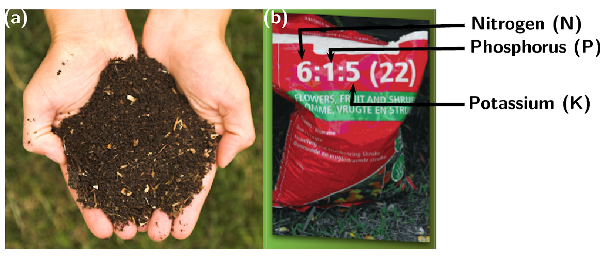
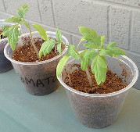

## 14.3 Fertilisers (ESCRY)

### The role of fertilisers (ESCRZ)

The importance of fertilisers is discussed and how to use NPK ratios in calculations.

Refer to the [Chemical
                                        Industries Resource Pack](https://vula.uct.ac.za/access/content/group/9eafe770-4c41-4742-a414-0df36366abe6/Chem%20Ind%20Resource%20Pack/html/learner-sheets/F/LS_F1.pdf) for more information.

Plants are only able to absorb nutrients from the soil when they are *dissolved* in
                                water so that their root systems can absorb the nutrients. Nitrogen gas
                                (\(\text{N}_{2}\)) for example, cannot be absorbed in the gas form, and needs to be
                                changed into an ion that is soluble in water, for example the nitrate ion
                                (\(\text{NO}_{3}^{-}\)). In the same way phosphorus is absorbed as phosphate ions
                                (\(\text{PO}_{4}^{3-}\)).

Plants will grow best in soil that is able to provide sufficient nutrients to them. Natural
                                processes, like the nitrogen cycle, replace nutrients in the soil. However, these
                                natural processes of maintaining soil nutrients take a long time. As populations grow
                                and the demand for food increases, the soil has to supply nutrients faster than the
                                natural processes can sustain. This places more and more strain on the soil to be able
                                to produce a crop.

Often, cultivation practices don’t give the soil enough time to recover and to replace
                                the nutrients that have been lost. Today, fertilisers play a very important role in
                                *restoring soil nutrients* so that crop yields can stay high. Some of these
                                fertilisers are **organic** (e.g. compost, manure and fishmeal), which
                                means that they started off as part of something living. Industrial (commercial)
                                fertilisers are **inorganic** (for example ammonium nitrate
                                (\(\text{NH}_{4}\text{NO}_{3}\)) or super phosphates
                                (\(\text{Ca}(\text{H}_{2}\text{PO}_{4})_{2}\)) and have the advantage of being in a
                                *soluble form* that can be absorbed by a plant immediately.

Fertiliser
A fertiliser is a chemical compound that is given to a plant to promote growth.

Fertilisers usually provide the three major plant nutrients (nitrogen, phosphorus and
                                potassium). Fertilisers are in general applied to the soil so that the nutrients are
                                absorbed by plants through their roots.

Organic and inorganic fertilisers
**Organic** fertilisers are made from *natural products*, like
                                        manure or compost. **Inorganic** fertilisers refer to
                                        *industrially produced compounds*.

Figure 14.2: Examples of **(a)** organic (compost) and
                                                **(b)** inorganic (industrially made) fertilisers
                                                indicating the NPK ratio that will be discussed later.

Photos by Kessner Photography on wikipedia and Elvera Viljoen in the UCT
                                                Chemical Engineering Chemical Industries Resource pack.

<QuizCard id="s12-14-03a" title="Interactive Exercise 14.2" question="Select the correct word or term for the following definition: A chemical compound that is given to a plant to promote growth." options=["fertiliser", "vitamin", "pesticide"] answer="fertiliser" hint="" explanation="Correct answer: fertiliser Submit your answer as: fertiliser" />

<QuizCard id="s12-14-03a" title="Interactive Exercise 14.2" question="Select the correct word or term for the following definition: A fertiliser that is produced industrially." options=["plant food", "inorganic fertiliser", "organic fertiliser"] answer="plant food" hint="" explanation="Correct answer: inorganic fertiliser Submit your answer as: inorganic fertiliser" />

<QuizCard id="s12-14-03a" title="Interactive Exercise 14.2" question="Select the correct word or term for the following definition: A fertiliser made from natural products, like manure or compost" options=["organic fertiliser", "inorganic fertiliser", "plant food"] answer="organic fertiliser" hint="" explanation="Correct answer: organic fertiliser Submit your answer as: organic fertiliser" />

### The NPK ratio (ESCS2)

Fertiliser packaging contains a set of numbers, for example
                                \(\text{6}\):\(\text{1}\):\(\text{5}\) (see Figure 14.2). These numbers are called the **NPK
                                        ratio**, and they give the mass ratio of nitrogen, phosphorus and
                                potassium in the fertiliser.

The NPK ratio expresses the content of each nutrient as a percentage of N, P and K in this
                                order. A number in brackets after this ratio indicates the percentage by mass of N, P
                                and K that is present in the fertiliser (what percentage of the total fertiliser is N, P
                                and K). For example:

38% of the total fertiliser is nitrogen, phosphorus or potassium.

\(\%\) **N**: \(\text{3}\) in every \(\text{9}\) parts of the 38% contains
                                nitrogen (N)

\(\%\) **P**: \(\text{1}\) in every \(\text{9}\) parts of the 38% contains
                                phosphorus (P)

\(\%\) **K**: \(\text{5}\) in every \(\text{9}\) parts of the 38% contains
                                potassium (K)

Table 14.3 below gives an idea of the
                                amounts of nitrogen, phosphorus and potassium there are in different types of
                                fertilisers.

<QuizCard id="s12-14-03b" title="Interactive Exercise 14.3" question="Select the correct word or term for the following definition: A ratio expressing the amount of nitrogen, phosphorus and potassium in a fertiliser" options=["fertiliser ratio", "NPK ratio", "the ratio"] answer="fertiliser ratio" hint="" explanation="Correct answer: NPK ratio Submit your answer as: NPK ratio" />

<QuizCard id="s12-14-03b" title="Interactive Exercise 14.3" question="What percentage of the fertiliser is composed of nitrogen, phosphorus and potassium?" options=[] answer="
                        35
                    " hint="You should enter a number here. If you want to, you can use a space to separate thousands.                Example: 12 800,25 For scientific notation you need to use the multiply symbol                ( ∗ ) and the exponent symbol ( ^ ). For example 6,673 × 10 −11 should be written as: 6,673 ∗ 10^−11" explanation="The number in brackets is the percentage of the fertiliser that contains nitrogen, phosphorus and potassium: N:P:K (percentage) 3 - 1 - 6 (35) In this example the percentage is \(\text{35}\%\) . Submit your answer as:" />

<Callout type="note" title="Note">
A starter fertiliser is usually used when seeds or young plants are planted. It has
                                        high concentrations of nitrogen, to boost plant growth, and phosphorus to boost
                                        root growth.

</Callout>

| Description | Grade (NPK ratio) |
| --- | --- |
| Ammonium nitrate | \(\text{34}\):\(\text{0}\):\(\text{0}\) |
| Urea | \(\text{46}\):\(\text{0}\):\(\text{0}\) |
| Bone meal | \(\text{4}\):\(\text{21}\):\(\text{1}\) |
| Seaweed | \(\text{1}\):\(\text{1}\):\(\text{5}\) |
| Starter fertilisers | \(\text{18}\):\(\text{24}\):\(\text{6}\) |
| Equal NPK fertilisers | \(\text{12}\):\(\text{12}\):\(\text{12}\) |
| High N, low P and medium K fertilisers | \(\text{25}\):\(\text{5}\):\(\text{15}\) |

Table 14.3: Common grades of some fertiliser materials.

Depending on the types of plants you are growing, and the growth stage they are in, you may
                                need to use a fertiliser with a slightly different ratio. For example, if you want to
                                **encourage root growth** in your plant you might choose a fertiliser with
                                a **greater ratio of phosphorus** in it. The main functions of each
                                nutrient (N, P, K) are given in Table 14.4. Remember to refer to [Table 14.1](/read/science/grade-12/the-chemical-industry/14-the-chemical-industry-02#tab:chemind:nonmineralnutrientsource)
                                and [Table 14.2](/read/science/grade-12/the-chemical-industry/14-the-chemical-industry-02#tab:chemind:mineralnutrientsource) as
                                well.

| Nutrient | Promotes | When to use |
| --- | --- | --- |
| Nitrogen (N) | leafy plant growth, faster plant growth | on lawns and other plants with lots of green leaves |
| Phosphorus (P) | strong roots, healthy fruit, blooming | on flowers and flower beds |
| Potassium (K) | disease resistance, growth of fruit | on fruit bearing plants |

Table 14.4: The types of plant growth different nutrients promote.

Some countries express the phosphorus content as \(\text{P}_{2}\text{O}_{5}\) and potassium
                                content as \(\text{K}_{2}\text{O}\). South Africa expresses the NPK ratio in terms of
                                the elements present as explained above. The rest of the fertiliser (62%) is made up of
                                fillers, such as gypsum, lime and sand. Other *micronutrients*, such as calcium
                                (\(\text{Ca}\)), sulfur (\(\text{S}\)) and magnesium (\(\text{Mg}\)), are often added to
                                the mixture.

<Callout type="tip" title="Worked example 1: NPK ratios">
**Question:**
Calculate the mass of nitrogen (N), phosphorus (P) and potassium (K) that is
                                                present in \(\text{500}\) \(\text{g}\) of industrial fertiliser with a
                                                NPK ratio of \(\text{5}\):\(\text{2}\):\(\text{3}\) (\(\text{40}\)).

**Determine the mass of the total nutrients in the fertiliser
                                                sample.:**
40% of the sample contains nutrients, therefore:

40% of \(\text{500}\) \(\text{g}\) = \(\text{0,4}\) x \(\text{500}\)
                                                \(\text{g}\) = \(\text{200}\) \(\text{g}\) which contains nutrients.

**Determine the mass of the specific component in the sample:**
For every \(\text{5}\) units of nitrogen there are \(\text{2}\) units of
                                                phosphorus and \(\text{3}\) units of potassium so the total number of
                                                units is \(\text{10}\).

\(\text{5}\) of the \(\text{10}\) units are nitrogen, therefore:

\(\dfrac{5}{10}\times\) \(\text{200}\) \(\text{g}\) = \(\text{100}\)
                                                \(\text{g}\) will be nitrogen (N).

\(\text{2}\) of the \(\text{10}\) units are phosphorus, therefore:

\(\dfrac{2}{10}\times\) \(\text{200}\) \(\text{g}\) = \(\text{40}\)
                                                \(\text{g}\) will be phosphorus (P).

\(\text{3}\) of the \(\text{10}\) units are potassium, therefore:

\(\dfrac{3}{10}\times\) \(\text{200}\) \(\text{g}\) = \(\text{60}\)
                                                \(\text{g}\) will be potassium (K).
</Callout>

<Callout type="tip" title="Worked example 2: NPK ratios">
**Question:**
Calculate the mole ratio of an industrial fertiliser with the NPK ratio of
                                                \(\text{5}\):\(\text{2}\):\(\text{3}\) (\(\text{40}\)).

**Calculate the mass of N, P and K in a \(\text{500}\)
                                                \(\text{g}\) sample of the fertiliser:**
As we are calculating the mole ratio, any amount of fertiliser can be
                                                assumed.

As in the previous worked example the ratio is
                                                \(\text{5}\):\(\text{2}\):\(\text{3}\) (\(\text{40}\)), so the mass of
                                                nutrients will be \(\text{200}\) \(\text{g}\). Therefore:

The mass of N = \(\dfrac{5}{10}\times\) \(\text{200}\) \(\text{g}\) =
                                                \(\text{100}\) \(\text{g}\).

The mass of P = \(\dfrac{2}{10}\times\) \(\text{200}\) \(\text{g}\) =
                                                \(\text{40}\) \(\text{g}\).

The mass of K = \(\dfrac{3}{10}\times\) \(\text{200}\) \(\text{g}\) =
                                                \(\text{60}\) \(\text{g}\).

**Calculate the number of moles for each element in this sample
                                                of fertiliser:**
\(\text{n} = \dfrac{\text{m}}{\text{M}}\)

The molar mass (M) for N = \(\text{14,0}\) \(\text{g·mol$^{-1}$}\)

Therefore n for nitrogen = \(\dfrac{\text{100}{\text{ g}}}{\text{14,0}{\text{
                                                g·mol}}^{-1}}\) = \(\text{7,14}\) \(\text{mol}\)

M for P = \(\text{31,0}\) \(\text{g·mol$^{-1}$}\)

Therefore n for phosphorus = \(\dfrac{\text{40}{\text{
                                                g}}}{\text{31,0}{\text{ g·mol}}^{-1}}\) = \(\text{1,29}\)
                                                \(\text{mol}\)

M for K = \(\text{39,1}\) \(\text{g·mol$^{-1}$}\)

Therefore n for potassium = \(\dfrac{\text{60}{\text{ g}}}{\text{39,1}{\text{
                                                g·mol}}^{-1}}\) = \(\text{1,53}\) \(\text{mol}\)

**Determine the mole ratio:**
N:P:K mole ratio = \(\text{7,14}\) : \(\text{1,29}\) : \(\text{1,53}\)

To get the mole ratio divide all the numbers by the smallest number
                                                (\(\text{1,29}\)):

\(\text{5,5}\) : \(\text{1}\) : \(\text{1,2}\)

The ratio should be expressed as whole numbers:

\(\text{55}\) : \(\text{10}\) : \(\text{12}\)
</Callout>

**Note:** If the percentage purity is not given (the number in brackets –
                                e.g. 40 in the worked example above), then you can assume that it is a 100% pure
                                fertiliser and no fillers were added.

\(\text{N}:\text{P}_{2}\text{O}_{5}:\text{K}_{2}\text{O}\)

As mentioned previously, in South Africa the NPK ratio is expressed in elemental
                                        form, for example the P in the ratio refers to the mass of the element
                                        phosphorus (P). However, in some countries the ratios are expressed in compound
                                        form: \(\text{N}\):\(\text{P}_{2}\text{O}_{5}\):\(\text{K}_{2}\text{O}\).
                                        Nitrogen still refers to the element nitrogen, but phosphorus and potassium
                                        refer to the compounds phosphorus pentoxide (\(\text{P}_{2}\text{O}_{5}\)) and
                                        potassium oxide (\(\text{K}_{2}\text{O}\)). This example will show you how to
                                        calculate the mass or moles when a compound ratio is given.

<Callout type="tip" title="Worked example 3: NPK ratios in other countries">
**Question:**
Calculate the moles of phosphorus (P) in \(\text{120}\) \(\text{g}\) of a
                                                fertiliser with the
                                                \(\text{N}\):\(\text{P}_{2}\text{O}_{5}\):\(\text{K}_{2}\text{O}\) mass
                                                ratio of \(\text{4}\):\(\text{3}\):\(\text{8}\) (\(\text{50}\)).

**Calculate the mass of nutrients in the sample of fertiliser:**
50% of the sample contains nutrients.

50% of \(\text{120}\) \(\text{g}\) = \(\text{0,5}\) x \(\text{120}\)
                                                \(\text{g}\) = \(\text{60}\) \(\text{g}\) which contains nutrients.

**Calculate the mass of \(\text{P}_{2}\text{O}_{5}\):**
The \(\text{N}\):\(\text{P}_{2}\text{O}_{5}\):\(\text{K}_{2}\text{O}\) ratio
                                                is \(\text{4}\) : \(\text{3}\) : \(\text{8}\). \(\text{4}\) +
                                                \(\text{3}\) + \(\text{8}\) = \(\text{15}\). Therefore:

\(\text{3}\) of the \(\text{15}\) units are \(\text{P}_{2}\text{O}_{5}\).

The mass of \(\text{P}_{2}\text{O}_{5}\) = \(\dfrac{3}{15} \times\)
                                                \(\text{60}\) \(\text{g}\) = \(\text{12}\) \(\text{g}\).

**Calculate the number of moles of \(\text{P}_{2}\text{O}_{5}\):**
\(\text{n} = \dfrac{\text{m}}{\text{M}}\)

M(\(\text{P}_{2}\text{O}_{5}\)) = \(\text{2}\) x \(\text{31,0}\)
                                                \(\text{g·mol$^{-1}$}\) + \(\text{5}\) x \(\text{16,0}\)
                                                \(\text{g·mol$^{-1}$}\) = \(\text{142,0}\)
                                                \(\text{g·mol$^{-1}$}\)

Therefore n(\(\text{P}_{2}\text{O}_{5}\)) = \(\dfrac{\text{12}{\text{
                                                g}}}{\text{142,0}{\text{ g·mol}}^{-1}}\) = \(\text{0,0845}\)
                                                \(\text{mol}\)

**Calculate the number of moles of \(\text{P}\):**
For every \(\text{1}\) mole of \(\text{P}_{2}\text{O}_{5}\) there are
                                                \(\text{2}\) moles of \(\text{P}\) atoms.

Therefore, n(\(\text{P}\)) = \(\text{2}\) x \(\text{0,0845}\) \(\text{mol}\)
                                                = \(\text{0,17}\) \(\text{mol}\)
</Callout>

For this activity leaners should work on their own.

**Solutions:**

2. The NPK ratio for bone meal is \(\text{4}\) : \(\text{21}\) :
                                                           \(\text{1}\). \(\text{4}\) + \(\text{21}\) + \(\text{1}\) =
                                                           \(\text{26}\).
   \(\text{21}\) of the \(\text{26}\) units are \(\text{P}\).
   Assume a 100% purity of the bone meal, so the entire \(\text{250}\)
                                                           \(\text{g}\) is nutrients.
   m(\(\text{P}\)) = \(\dfrac{21}{26} \times\) \(\text{250}\)
                                                           \(\text{g}\) = \(\text{201,92}\) \(\text{g}\)
4. Assume a 100% purity of the ammonium nitrate, so the entire
                                                           \(\text{200}\) \(\text{g}\) is \(\text{NH}_{4}\text{NO}_{3}\).
   The NPK ratio for ammonium nitrate is \(\text{34}\) : \(\text{0}\) :
                                                           \(\text{0}\). Therefore there is no phosphorus or potassium in
                                                           the fertiliser.
   m(\(\text{NH}_{4}\text{NO}_{3}\)) = \(\text{200}\) \(\text{g}\)
   M(\(\text{NH}_{4}\text{NO}_{3}\)) = (\(\text{2}\) x \(\text{14,0}\) +
                                                           \(\text{4}\) x \(\text{1,01}\) + \(\text{3}\) x \(\text{16,0}\))
                                                           \(\text{g·mol$^{-1}$}\) = \(\text{80,04}\)
                                                           \(\text{g·mol$^{-1}$}\)
   n(\(\text{NH}_{4}\text{NO}_{3}\)) = \(\dfrac{\text{m (g)}}{\text{M
                                                           (g·mol}^{-1}{\text{)}}} = \dfrac{\text{200} {\text{
                                                           g}}}{\text{80,04} {\text{ g·mol}}^{-1}}\) = \(\text{2,5}\)
                                                           \(\text{mol}\)
   For every \(\text{1}\) mole of \(\text{NH}_{4}\text{NO}_{3}\) there
                                                           are \(\text{2}\) moles of \(\text{N}\).
   n(\(\text{N}\)) = \(\text{2}\) x \(\text{2,5}\) \(\text{mol}\) =
                                                           \(\text{5}\) \(\text{mol}\)
6. The NPK ratio for seaweed is \(\text{1}\) : \(\text{1}\) :
                                                           \(\text{5}\). \(\text{1}\) + \(\text{1}\) + \(\text{5}\) =
                                                           \(\text{7}\).
   \(\text{5}\) of the \(\text{7}\) units are postassium (\(\text{K}\)).
   Assume a 100% purity of the seaweed, so the entire \(\text{100}\)
                                                           \(\text{g}\) is nutrients.
   m(\(\text{K}\)) = \(\dfrac{5}{7} \times\) \(\text{100}\) \(\text{g}\)
                                                           = \(\text{71,4}\) \(\text{g}\)
8. 40% of the sample is nutrients. The mass of nutrients in the sample
                                                           is: \(\text{0,4}\) x \(\text{100}\) \(\text{g}\) = \(\text{40}\)
                                                           \(\text{g}\)
   The \(\text{N}:\text{P}_{2}\text{O}_{5}\text{K}_{2}\text{O}\) ratio
                                                           is \(\text{5}\) : \(\text{1}\) : \(\text{2}\). \(\text{5}\) +
                                                           \(\text{1}\) + \(\text{2}\) = \(\text{8}\).
   \(\text{2}\) of the \(\text{8}\) units are \(\text{K}_{2}\text{O}\).
   m(\(\text{K}_{2}\text{O}\)) = \(\dfrac{2}{8} \times\) \(\text{40}\)
                                                           \(\text{g}\) = \(\text{10}\) \(\text{g}\)
   M(\(\text{K}_{2}\text{O}\)) = (\(\text{2}\) x \(\text{39,1}\) +
                                                           \(\text{16,0}\)) \(\text{g·mol$^{-1}$}\) = \(\text{94,2}\)
                                                           \(\text{g·mol$^{-1}$}\)
   n(\(\text{K}_{2}\text{O}\)) = \(\dfrac{\text{10} {\text{
                                                           g}}}{\text{94,2} {\text{ g·mol}}^{-1}}\)= \(\text{0,106}\)
                                                           \(\text{mol}\)
   For every \(\text{1}\) mole of \(\text{K}_{2}\text{O}\) there are
                                                           \(\text{2}\) moles of \(\text{K}\).
   n(\(\text{K}\)) = \(\text{2}\) x \(\text{0,106}\) \(\text{mol}\) =
                                                           \(\text{0,21}\) \(\text{mol}\)

## NPK ratios

Use Table 14.3, if needed, to
                                        answer the following questions:

2. Calculate the mass of phosphorus that is present in \(\text{250}\)
                                                           \(\text{g}\) of bone meal.
4. Calculate the moles of nitrogen that are present in \(\text{200}\)
                                                           \(\text{g}\) of ammonium nitrate
                                                           (\(\text{NH}_{4}\text{NO}_{3}\)).
6. Calculate the mass of potassium that is present in \(\text{100}\)
                                                           \(\text{g}\) of seaweed.
8. Calculate the number of moles of potassium in \(\text{100}\)
                                                           \(\text{g}\) of a commercial fertiliser with the
                                                           \(\text{N}\):\(\text{P}_{2}\text{O}_{5}\):\(\text{K}_{2}\text{O}\)
                                                           mass ratio of \(\text{5}\):\(\text{1}\):\(\text{2}\)
                                                           (\(\text{40}\)).

## The role of fertilisers

### Textbook Exercise 14.1

A starter fertiliser is usually used when seeds or young
                                                                plants are planted.

Use Table
                                                                        14.3 to answer the following questions.

**Problem:**
What is the NPK ratio of a starter fertiliser?

**Solution:**
\(\text{18}\):\(\text{24}\):\(\text{6}\)

**Problem:**
Which nutrient is present in the lowest
                                                                        concentration?

**Solution:**
potassium (\(\text{K}\))

**Problem:**
Do you think an equal NPK fertiliser will be a good
                                                                        starter fertiliser for new plants? Explain your
                                                                        answer using information from Tables Table 14.1 - Table 14.4.

**Solution:**
No. New plants need nitrogen (to boost plant growth)
                                                                        and phosphorus (for root growth). An equal NPK
                                                                        fertiliser has equal amounts of N, P and K and
                                                                        therefore would not promote new plant growth as
                                                                        much. An actual starter fertiliser contains much
                                                                        higher amounts of nitrogen and phosphorus
                                                                        (\(\text{18}\):\(\text{24}\):\(\text{6}\)).

**Problem:**
Do you think bone meal is a good fertiliser to use for
                                                                flowering plants? Explain your answer using Tables Table 14.1 - Table 14.4.

**Solution:**
Yes. The NPK ratio of bone meal is \(\text{4}\) :
                                                                \(\text{21}\) : \(\text{1}\). Bone meal has a high
                                                                phosphorus (P) content (\(\text{21}\) of \(\text{26}\)
                                                                units are P). Phosphorus is good for flowering plants so
                                                                a high phosphorus content would make bone meal a good
                                                                fertiliser to use.

**Problem:**
Determine the mass of each of the nutrient components in a
                                                                \(\text{600}\) \(\text{g}\) bag of the fertiliser shown
                                                                in Figure 14.2 (it is
                                                                produced in South Africa).

**Solution:**
The NPK mass ratio is \(\text{6}\) : \(\text{1}\) :
                                                                \(\text{5}\) (\(\text{22}\)). \(\text{6}\) +
                                                                \(\text{1}\) + \(\text{5}\) = \(\text{12}\).

Determine the mass of the total nutrients in the fertiliser
                                                                sample:

22% of the sample contains nutrients, therefore:

The mass of nutrients in the sample = \(\text{0,22}\) x
                                                                \(\text{600}\) \(\text{g}\) = \(\text{132}\)
                                                                \(\text{g}\)

\(\text{6}\) of the \(\text{12}\) units are nitrogen,
                                                                therefore:

m(\(\text{N}\)) = \(\dfrac{6}{12}\times\) \(\text{132}\)
                                                                \(\text{g}\) = \(\text{66}\) \(\text{g}\)

\(\text{1}\) of the \(\text{12}\) units is phosphorus,
                                                                therefore:

m(\(\text{P}\)) = \(\dfrac{1}{12}\times\) \(\text{132}\)
                                                                \(\text{g}\) = \(\text{11}\) \(\text{g}\)

\(\text{5}\) of the \(\text{12}\) units are potassium,
                                                                therefore:

m(\(\text{K}\)) = \(\dfrac{5}{12}\times\) \(\text{132}\)
                                                                \(\text{g}\) = \(\text{55}\) \(\text{g}\)

**Problem:**
You have determined that your vegetable garden will need
                                                                \(\text{12}\) \(\text{g}\) of nitrogen. The fertiliser
                                                                you have has \(\text{4}\):\(\text{2}\):\(\text{3}\)
                                                                (\(\text{40}\)) written on the packet. How many grams of
                                                                fertiliser will you need for your garden?

**Solution:**
The NPK mass ratio is \(\text{4}\) : \(\text{2}\) :
                                                                \(\text{3}\) (\(\text{40}\)). \(\text{4}\) +
                                                                \(\text{2}\) + \(\text{3}\) = \(\text{9}\).

\(\text{4}\) of the \(\text{9}\) units are nitrogen and
                                                                \(\text{12}\) \(\text{g}\) of nitrogen is needed,
                                                                therefore:

\(\dfrac{4}{9}\times\) total mass of nutrients required =
                                                                \(\text{12}\) \(\text{g}\).

Total mass of nutrients required = \(\text{12}\) \(\text{g}\)
                                                                \(\times \dfrac{9}{4}\) = \(\text{27}\) \(\text{g}\)

40% of the sample contains nutrients, therefore:

40% of fertiliser required = \(\text{27}\) \(\text{g}\)

Total fertiliser required = \(\dfrac{\text{27}{\text{
                                                                g}}}{\text{0,40}}\)= \(\text{67,5}\) \(\text{g}\).

**Problem:**
How many moles of potassium is present in \(\text{150}\)
                                                                \(\text{g}\) of commercial fertiliser with the
                                                                \(\text{N}\):\(\text{P}_{2}\text{O}_{5}\):\(\text{K}_{2}\text{O}\)
                                                                mass ratio of \(\text{1}\):\(\text{2}\):\(\text{5}\).

**Solution:**
The \(\text{N}\):\(\text{P}_{2}\text{O}_{5}\):\(\text{K}_{2}\text{O}\)
                                                                ratio is \(\text{1}\) : \(\text{2}\) : \(\text{5}\).
                                                                \(\text{1}\) + \(\text{2}\) + \(\text{5}\) =
                                                                \(\text{8}\).

No percentage purity is given, therefore assume 100% purty.
                                                                So the entire \(\text{15}\) \(\text{g}\) is nutrients.

\(\text{5}\) units of the \(\text{8}\) units are
                                                                \(\text{K}_{2}\text{O}\)

M(\(\text{K}_{2}\text{O}\)) = (\(\text{2}\) x \(\text{39,1}\)
                                                                + \(\text{16,0}\)) \(\text{g·mol$^{-1}$}\) =
                                                                \(\text{94,2}\) \(\text{g·mol$^{-1}$}\)

m(\(\text{K}_{2}\text{O}\)) = \(\dfrac{5}{8}\times\)
                                                                \(\text{150}\) \(\text{g}\) = \(\text{93,75}\)
                                                                \(\text{g}\).

n(\(\text{K}_{2}\text{O}\)) = \(\dfrac{\text{m (g)}}
                                                                {\text{M(g·mol}^{-1}{\text{)}}} =
                                                                \dfrac{\text{93,75}
                                                                {\text{g}}}{\text{94,2}{\text{ g·mol}}^{-1}}\) =
                                                                \(\text{0,995}\) \(\text{mol}\)

For every \(\text{1}\) mole of \(\text{K}_{2}\text{O}\) there
                                                                are \(\text{2}\) moles of \(\text{K}\) atoms.

Therefore, n(\(\text{K}\)) = \(\text{2}\) x \(\text{0,995}\)
                                                                \(\text{mol}\) = \(\text{1,99}\) \(\text{mol}\)
