## 14.4 The fertiliser industry (ESCS3)

### The industrial production of fertilisers (ESCS4)

This section is content heavy and an important sub-section in this chapter. It should
                                        be linked to rate of reactions, equilibrium and acid-base reactions done earlier
                                        in Grade 12.

Two lessons are allocated, but if three are available it would be advisable to spend
                                        this extra time on this sub-section (although the depth of information provided
                                        here is not required from the learners). For this section a [poster](https://vula.uct.ac.za/access/content/group/9eafe770-4c41-4742-a414-0df36366abe6/Chem%20Ind%20Resource%20Pack/html/teachers-guide/posters/F_Poster.pdf),
                                        an [animation](https://vula.uct.ac.za/access/content/group/9eafe770-4c41-4742-a414-0df36366abe6/Chem%20Ind%20Resource%20Pack/html/animations/Fertilisers.swf)
                                        and accompanying [worksheet](https://vula.uct.ac.za/access/content/group/9eafe770-4c41-4742-a414-0df36366abe6/Chem%20Ind%20Resource%20Pack/html/teachers-guide/AnimationMemos/TG_A_M_F.pdf)
                                        are available. These can be used as an introduction to the section as well as a
                                        classwork activity. Play the animation once or twice without the learners
                                        writing anything, then hand out the worksheet, and play the animation again
                                        so that learners can complete the worksheet.

For more information on this section refer to the [Chemical
                                        Industries Resource Pack](https://vula.uct.ac.za/access/content/group/9eafe770-4c41-4742-a414-0df36366abe6/Chem%20Ind%20Resource%20Pack/html/teachers-guide/posters/F_Poster.pdf).

The industrial production of fertilisers involves several processes. Figure 14.3
                                summarises how a number of different industrial processes are used to manufacture a
                                variety of fertilisers. In the following sections we will discuss the various processes
                                indicated on this diagram.

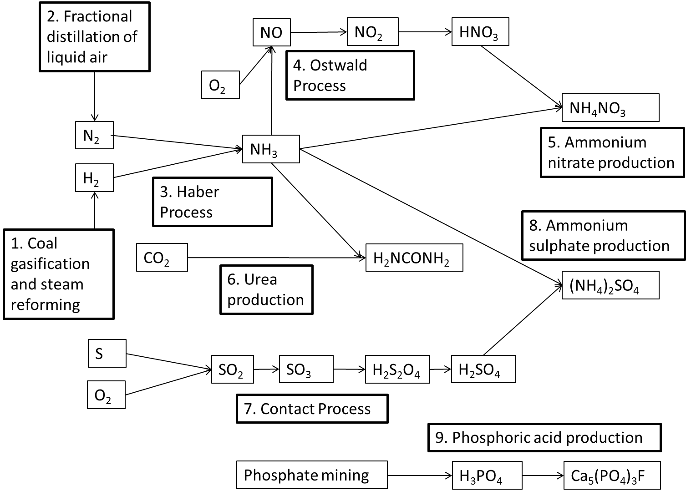

Figure 14.3: The industrial manufacturing of fertilisers

### Producing hydrogen: Coal gasification and steam reforming at Sasol (ESCS5)

<Callout type="note" title="Note">
Sasol is an international company that was founded in Sasolburg, South Africa, in
                                        1950. It employs over \(\text{34 000}\) people in at least \(\text{38}\)
                                        countries and has interests in synthetic fuels, mining, oil, gas and chemistry.
</Callout>

Fossil fuels are the main source of industrial hydrogen. Hydrogen can be generated from
                                **natural gas** or **coal**. These processes are used by [Sasol](https://vula.uct.ac.za/access/content/group/9eafe770-4c41-4742-a414-0df36366abe6/Chem%20Ind%20Resource%20Pack/html/teachers-guide/posters/P_poster.pdf)
                                at their Gas-to-Liquid (GTL) and Coal-to-Liquid (CTL) facilities. Hydrogen is usually
                                produced by the **steam reforming** of methane gas (natural gas). At high
                                temperatures (\(\text{700}\) – \(\text{1 100}\)\(\text{°C}\)), steam
                                (\(\text{H}_{2}\text{O}\)) reacts with **methane** (\(\text{CH}_{4}\)) in
                                an endothermic reaction to yield **syngas**, a mixture of *carbon
                                        monoxide* (\(\text{CO}\)) and
                                *hydrogen* (\(\text{H}_{2}\)).

<Callout type="tip" title="Note">
You are not required to know this information in as much depth as is provided here,
                                        but the extra information should help your understanding of the subject.
</Callout>

\(\text{CH}_{4}(\text{g}) + \text{H}_{2}\text{O}(\text{g})\) \(\to\) \(\text{CO}(\text{g}) +
                                3\text{H}_{2}(\text{g})\)

During a second stage, which takes place at a lower temperature of about
                                \(\text{130}\)\(\text{°C}\), the exothermic reaction generates additional hydrogen.
                                This is called a **water gas shift reaction**.

\(\text{CO}(\text{g}) + \text{H}_{2}\text{O}(\text{g})\) \(\to\) \(\text{CO}_{2}(\text{g}) +
                                \text{H}_{2}(\text{g})\)

Essentially, the **oxygen** (O) atom is stripped from the additional water
                                (steam) to oxidise \(\text{CO}\) to \(\text{CO}_{2}\). This oxidation also provides
                                energy to maintain the reaction.

Coal can also be used to produce syngas in a similar way to natural gas. The reactions are
                                shown below:

\(\text{C}(\text{s}) + \text{H}_{2}\text{O}(\text{g})\) \(\to\) \(\text{CO}(\text{g}) +
                                \text{H}_{2}(\text{g})\)

\(\text{CO}(\text{g}) + \text{H}_{2}\text{O}(\text{g})\) \(\to\) \(\text{CO}_{2}(\text{g}) +
                                \text{H}_{2}(\text{g})\)

Remember that **yield** describes the quantity of product in a container
                                relative to the maximum product possible.

### Obtaining nitrogen: Fractional distillation of liquefied air (ESCS6)

Fractional distillation is a separation method. It uses the difference in boiling
                                temperatures of the components of a mixture to separate those components.

- The mixture is heated to convert the components into the vapour (gas) phase.
- The vapour mixture is then pumped into a tall separation column (called a
                                                  fractional distillation column), usually at the bottom of the column.
- As the vapour mixture moves up the column and cools, the different components
                                                  (called fractions) condense as the temperature drops below the various
                                                  boiling point temperatures.
- These fractions are collected using collection trays.
- The fractions can be removed from the mixture in this way and thus the
                                                  components are separated.

This process is used to separate the components of air or crude oil. Air is a mixture of
                                gases, mainly nitrogen (\(\text{N}_{2}\)) and oxygen (\(\text{O}_{2}\)). Liquefied air
                                (compressed and cooled to \(-\text{200}\)\(\text{°C}\)) is pumped into the
                                fractional distillation column. Nitrogen gas has the lowest boiling point temperature
                                and is collected at the top of the column (Figure 14.4).

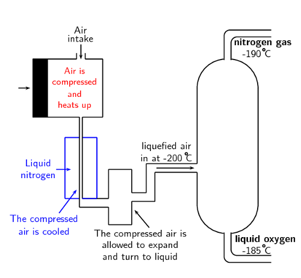

Figure 14.4: A fractional distillation column for the separation of the
                                                components of air.

### Producing ammonia: The Haber process (ESCS7)

Ammonia (\(\text{NH}_{3}\)) plays an important role in the manufacturing process of
                                fertilisers. The industrial process used to produce ammonia is called the **[Haber
                                                process](https://vula.uct.ac.za/access/content/group/9eafe770-4c41-4742-a414-0df36366abe6/Chem%20Ind%20Resource%20Pack/html/learner-sheets/F/LS_F4.pdf)**. In this reaction nitrogen gas and hydrogen gas
                                react to produce ammonia gas. The equation for the Haber process is:

\(\text{N}_{2}(\text{g}) + 3\text{H}_{2}(\text{g})\) \(\rightleftharpoons\)
                                \(2\text{NH}_{3}(\text{g})\)

This reaction takes place in the presence of an iron (Fe) catalyst under high pressure
                                (\(\text{200}\) atmospheres (atm)) and temperature (\(\text{450}\) –
                                \(\text{500}\)\(\text{°C}\)) conditions.

<Callout type="note" title="Note">
\(\text{1}\) \(\text{atm}\) = \(\text{101,3}\) \(\text{kPa}\)
</Callout>

By the \(\text{20}\)th century, a number of methods had been developed to *fix*
                                atmospheric nitrogen, in other words to make it usable for plants. Sources of nitrogen
                                for fertilisers included *saltpetre* (\(\text{NaNO}_{3}\)) from Chile, and guano.
                                Guano is the droppings of seabirds, bats and also seals. In the early \(\text{20}\)th
                                century, before the start of the First World War, the Haber process was developed by two
                                German chemists, Fritz Haber and Karl Bosch. They determined what the best conditions
                                were in order to get a high yield of ammonia, and found these to be **high
                                        temperature** and **high pressure**. During World War I, the
                                ammonia produced by the Haber process was used to make explosives.

<Callout type="note" title="Note">
The forward reaction of the Haber process is exothermic, so the forward reaction is
                                        favoured by low temperatures. However, low temperatures slow all chemical
                                        reactions. So, the Haber process requires high temperatures, and the ammonia is
                                        removed as soon as it is formed to prevent it being used in the reverse
                                        reaction.
</Callout>

<QuizCard id="s12-14-04a" title="Interactive Exercise 14.5" question="Adapted from DBE Nov 2015 Grade 12, P2, Q1.1 Physical constants \(·\) Chemistry formulas \(·\) Periodic table \(·\) Standard reduction potentials Which one of the following pairs of reactants is used in a reaction during the Haber process? A H 2 (g) and N 2 (g) B SO 3 (g) and O 2 (g) C NO(g) and O 2 (g) D H 2 O(ℓ) and H 2 S 2 O 7 (ℓ)" options=["A", "B", "C", "D"] answer="
                    0
                " hint="" explanation="Recall what you know about the Haber process The Haber process plays an important role in the manufacturing process of fertilisers. It is the reaction of nitrogen and hydrogen gas, at moderate temperature and high pressure, and in the presence of an iron catalyst, to produce ammonia: N 2 (g) \(\:+\:\) \(\text{3}\) H 2 (g) \(\rightarrow\) \(\downarrow\) \(\text{2}\) NH 3 (g) \(\qquad \Delta H < 0\) NOTE: The product of the Haber process, ammonia, can react with nitric acid to produce ammonium nitrate, NH 4 NO 3 , or with carbon dioxide to produce urea, (NH 2 ) 2 CO . However, neither of these reactions is part of the Haber process. Apply what you know about the Haber process From this we can see that the pair of reactants used in the Haber process are H 2 (g) and N 2 (g) . A \({\color{red}{{\checkmark}{\checkmark}}}\) H 2 (g) and N 2 (g) B SO 3 (g) and O 2 (g) C NO(g) and O 2 (g) D H 2 O(ℓ) and H 2 S 2 O 7 (ℓ) Therefore the correct option is A . Submit your answer as: A" />

### Producing nitric acid: The Ostwald process (ESCS8)

The **[Ostwald
                                                process](https://vula.uct.ac.za/access/content/group/9eafe770-4c41-4742-a414-0df36366abe6/Chem%20Ind%20Resource%20Pack/html/learner-sheets/F/LS_F5.pdf)** is used to produce nitric acid from ammonia. Nitric
                                acid can then be used in reactions that produce fertilisers. Ammonia is converted to
                                nitric acid in a three-step process.

Firstly ammonia is **oxidised** by heating it with oxygen, in the presence of a
                                platinum (\(\text{Pt}\)) catalyst, to form nitrogen monoxide (\(\text{NO}\)) and water.
                                This step is strongly **exothermic**, which makes it a useful heat source.
                                The reaction that takes place is:

\(4\text{NH}_{3}(\text{g}) + 5\text{O}_{2}(\text{g})\) \(\to\) \(4\text{NO}(\text{g}) +
                                6\text{H}_{2}\text{O}(\text{g})\)

In the second step, nitrogen monoxide is oxidised again to yield nitrogen dioxide
                                (\(\text{NO}_{2}\)) according to the following reaction:

\(2\text{NO}(\text{g}) + \text{O}_{2}(\text{g})\) \(\to\) \(2\text{NO}_{2}(\text{g})\)

In step three, nitrogen dioxide is absorbed by water to produce nitric acid
                                (\(\text{HNO}_{3}\)) as follows:

\(3\text{NO}_{2}(\text{g}) + \text{H}_{2}\text{O}(\text{ℓ})\) \(\to\)
                                \(2\text{HNO}_{3}(\text{aq}) + \text{NO}(\text{g})\)

Nitrogen monoxide, also known as nitrogen oxide or nitric oxide, is a by-product of this
                                reaction. The nitrogen monoxide is recycled and the acid is concentrated to the required
                                strength (e.g., for use in further chemical processes).

<QuizCard id="s12-14-04b" title="Interactive Exercise 14.6" question="Adapted from DBE Nov 2015 Grade 12, P2, Q10 Physical constants \(·\) Chemistry formulas \(·\) Periodic table \(·\) Standard reduction potentials Nitric acid is an acid that is used in the preparation of important fertilisers. Large amounts are prepared from ammonia and oxygen in industry. Answer the following questions about the industrial preparation of nitric acid:" options=["distillation of water", "Contact process", "dilution of nitric acid", "Haber process"] answer="
                    ['Ostwald', 'The Ostwald', 'The Ostwald process', 'Ostwald process', 'A Ostwald', 'A Ostwald process', 'An Ostwald process', 'An Ostwald']
                ,
                    ['4NH_{3}(g)+5O_{2}(g) \\rightleftharpoons 4NO(g)+6H_{2}O(g)', '4NH_{3}(g)+5O_{2}(g) \\rightarrow 4NO(g)+6H_{2}O(g)', '4NH_{3}+5O_{2} \\rightarrow 4NO+6H_{2}O', '4NH_{3}(g)+5O_{2}(g) \\rightleftharpoons 4NO(g)+6H_{2}O(g)', '4NH_{3}+5O_{2} \\rightleftharpoons 4NO+6H_{2}O', '2NO(g)+O_{2}(g) \\rightarrow 2NO_{2}(g)', '2NO+O_{2} \\rightarrow 2NO_{2}', '2NO(g)+O_{2}(g) \\rightleftharpoons 2NO_{2}(g)', '2NO+O_{2} \\rightleftharpoons 2NO_{2}', '3NO_{2}(g)+H_{2}O(l) \\rightarrow 2HNO_{3}(aq)+NO(g)', '3NO_{2}+H_{2}O \\rightarrow 2HNO_{3}+NO', '3NO_{2}(g)+H_{2}O(l) \\rightleftharpoons 2HNO_{3}(aq)+NO(g)', '3NO_{2}+H_{2}O \\rightleftharpoons 2HNO_{3}+NO']
                ,
                    0
                " hint="" explanation="What process is taking place? The Ostwald process is a three-step process used to produce nitric acid from ammonia. Recall what you know about the Ostwald process The first step is the catalytic oxidation of ammonia. In this step, ammonia and oxygen gas react when they are heated in the presence of a platinum catalyst to form nitrogen monoxide: \(\text{4}\) NH 3 (g) \(\:+\:\) \(\text{5}\) O 2 (g) \(\rightleftharpoons\) \(\updownarrow\) \(\text{4}\) NO(g) \(\:+\:\) \(\text{6}\) H 2 O(g) Then, the nitrogen monoxide is reacted with more oxygen (in the presence of water) to produce nitrogen dioxide: \(\text{2}\) NO(g) \(\:+\:\) O 2 (g) \(\rightleftharpoons\) \(\updownarrow\) \(\text{2}\) NO 2 (g) Finally, the nitrogen dioxide reacts with water to produce nitric acid. The nitrogen monoxide produced in this last step is recycled, and used as a reactant in the second step. \(\text{3}\) NO 2 (g) \(\:+\:\) H 2 O(ℓ) \(\rightleftharpoons\) \(\updownarrow\) \(\text{2}\) HNO 3 (aq) \(\:+\:\) NO(g) The balanced equation for any of the above reactions is acceptable. For example: \(\text{3}\) NO 2 (g) \(\:+\:\) H 2 O(ℓ) \(\rightleftharpoons\) \(\updownarrow\) \(\text{2}\) HNO 3 (aq) \(\:+\:\) NO(g) Choose the correct source for ammonia The correct source for ammonia from the options provided is the Haber process . Submit your answer as: and and Haber process" />

### Producing ammonium nitrate (ESCS9)

Nitric acid and ammonia can react together in an acid-base process to form the salt, ammonium
                                nitrate (\(\text{NH}_{4}\text{NO}_{3}\)). Ammonium nitrate is soluble in water and is
                                often used in fertilisers. The reaction is as follows:

\(\text{NH}_{3}(\text{ℓ}) + \text{HNO}_{3}(\text{ℓ})\) \(\to\)
                                \(\text{NH}_{4}\text{NO}_{3}(\text{s})\)

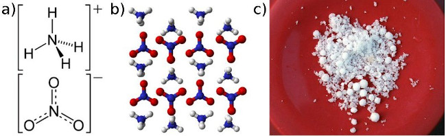

Figure 14.5: Ammonium nitrate presented as **a)** the structural
                                                formula, **b)** a three-dimensional molecular
                                                representation and **c)** solid crystals.

### Producing urea (ESCSB)

Urea (\((\text{NH}_{2})_{2}\text{CO}\)) is a nitrogen-containing compound that is produced on
                                a large scale worldwide. It has the highest nitrogen content (46,4%) of all solid
                                nitrogen-containing fertilisers that are commonly used, and is produced by the reaction
                                of *ammonia* with *carbon dioxide*. Two reactions are involved in
                                producing urea and ammonium carbamate (\(\text{H}_{2}\text{NCOONH}_{4}\)) is an
                                intermediate product.

\(2\text{NH}_{3}(\text{g}) + \text{CO}_{2}(\text{g})\) \(\rightleftharpoons\)
                                \(\text{H}_{2}\text{NCOONH}_{4}(\text{s})\)

\(\text{H}_{2}\text{NCOONH}_{4}(\text{s})\) \(\rightleftharpoons\)
                                \((\text{NH}_{2})_{2}\text{CO}(\text{aq}) + \text{H}_{2}\text{O}(\text{ℓ})\)

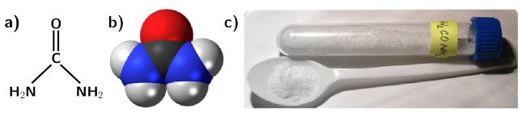

Figure 14.6: Urea presented as **a)** the structural formula,
                                                **b)** a space-filling three-dimensional model and
                                                **c)** solid crystals.

<Callout type="note" title="Note">
In 1828, the German chemist Friedrich Wöhler obtained urea by treating silver
                                        cyanate (\(\text{AgOCN}\)) with ammonium chloride (\(\text{NH}_{4}\text{Cl}\)):

\(\text{AgOCN} + \text{NH}_{4}\text{Cl}\) \(\to\) \((\text{NH}_{2})_{2}\text{CO} +
                                        \text{AgCl}\)

This was the first time an organic compound was artificially synthesised from
                                        inorganic starting materials, without the use of living organisms.
</Callout>

### Producing sulfuric acid: The Contact process (ESCSC)

Sulfuric acid (\(\text{H}_{2}\text{SO}_{4}\)) is produced from sulfur, oxygen and water
                                through the **[Contact
                                                process](https://vula.uct.ac.za/access/content/group/9eafe770-4c41-4742-a414-0df36366abe6/Chem%20Ind%20Resource%20Pack/html/learner-sheets/F/LS_F5.pdf)**. In the first step, sulfur is burned to produce
                                sulfur dioxide (\(\text{SO}_{2}\)):

\(\text{S}(\text{s}) + \text{O}_{2}(\text{g})\) \(\to\) \(\text{SO}_{2}(\text{g})\)

This is then oxidised to sulfur trioxide (\(\text{SO}_{3}\)) using oxygen in the presence of
                                a vanadium(V) oxide catalyst:

\(2\text{SO}_{2}(\text{g}) + \text{O}_{2}(\text{g})\) \(\rightleftharpoons\)
                                \(2\text{SO}_{3}(\text{g})\)

Finally the sulfur trioxide is treated with water to produce sulfuric acid with a purity of
                                \(\text{98}\) - 99%:

\(\text{SO}_{3}(\text{g}) + \text{H}_{2}\text{O}(\text{ℓ})\) \(\to\)
                                \(\text{H}_{2}\text{SO}_{4}(\text{ℓ})\)

<QuizCard id="s12-14-04c" title="Interactive Exercise 14.7" question="Adapted from DBE Nov 2016 Grade 12, P2, Q1.6 Physical constants \(·\) Chemistry formulas \(·\) Periodic table \(·\) Standard reduction potentials Consider the balanced equations for three reactions represented below: I 3NO 2 (g) \(+\) H 2 O(ℓ) \(\rightarrow\) \(\downarrow\) 2HNO 3 (aq) \(+\) NO(g) II H 2 S 2 O 7 (ℓ) \(+\) H 2 O(ℓ) \(\rightarrow\) \(\downarrow\) 2H 2 SO 4 (ℓ) III N 2 (g) \(+\) 3H 2 (g) \(\rightleftharpoons\) \(\updownarrow\) 2NH 3 (g) Which of the above reactions form part of the Contact process? A I only B II only C III only D I and III only" options=["A", "B", "C", "D"] answer="
                    1
                " hint="" explanation="Recall what you know about the Contact process The Contact process is a four-step process used to produce sulfuric acid. In the first step sulfur is burned in oxygen to produce sulfur dioxide: S(s) \(+\) O 2 (g) \(\rightarrow\) \(\downarrow\) SO 2 (g) Then the sulfur dioxide is reacted with more oxygen gas in the presence of a vanadium pentoxide (V 2 O 5 ) catalyst, to form sulfur trioxide. NOTE: The vanadium pentoxide is a contact catalyst. This step is why it's called the contact process! 2SO 2 (g) \(+\) O 2 (g) \(\rightleftharpoons\) \(\updownarrow\) 2SO 3 (g) The sulfur trioxide then reacts with sulfuric acid to form oleum (also known as fuming sulfuric acid) : SO 3 (g) \(+\) H 2 SO 4 (ℓ) \(\rightarrow\) \(\downarrow\) H 2 S 2 O 7 (ℓ) Finally, the oleum reacts with water to form more sulfuric acid. H 2 S 2 O 7 (ℓ) \(+\) H 2 O(ℓ) \(\rightarrow\) \(\downarrow\) 2H 2 SO 4 (ℓ) NOTE: The product of the Contact process, sulfuric acid, can react with ammonia to form ammonium sulfate, (NH 4 ) 2 SO 4 . It is also used in the production of phosphoric acid and super phosphates. However, these reactions are not part of the Contact process. Apply what you know about the Contact process Three equations were given in the question. I 3NO 2 (g) \(+\) H 2 O(ℓ) \(\rightarrow\) \(\downarrow\) 2HNO 3 (aq) \(+\) NO(g) II H 2 S 2 O 7 (ℓ) \(+\) H 2 O(ℓ) \(\rightarrow\) \(\downarrow\) 2H 2 SO 4 (ℓ) III N 2 (g) \(+\) 3H 2 (g) \(\rightleftharpoons\) \(\updownarrow\) 2NH 3 (g) Only Equation II is part of the Contact process. A I only B \({\color{red}{{\checkmark}{\checkmark}}}\) II only C III only D I and III only So the correct choice is Option B . Submit your answer as: B" />

### Producing ammonium sulfate (ESCSD)

Ammonium sulfate (\((\text{NH}_{4})_{2}\text{SO}_{4}\)) can be produced industrially through
                                a number of processes, one of which is the reaction of ammonia with sulfuric acid to
                                produce a solution of ammonium sulfate according to the acid-base reaction below:

\(2\text{NH}_{3}(\text{g}) + \text{H}_{2}\text{SO}_{4}(\text{ℓ})\)
                                \(\rightleftharpoons\)
                                \((\text{NH}_{4})_{2}\text{SO}_{4}(\text{s})\)

The ammonium sulfate solution is concentrated by evaporating the water until ammonium sulfate
                                crystals are formed.

### Producing phosphoric acid and super phosphates (ESCSF)

The production of phosphate fertilisers also includes a number of processes. The first is the
                                production of sulfuric acid through the **Contact process**. Sulfuric acid
                                is then used in a reaction with phosphate rock (e.g. fluorapatite
                                (\(\text{Ca}_{5}(\text{PO}_{4})_{3}\text{F}\))) to produce phosphoric acid
                                (\(\text{H}_{3}\text{PO}_{4}\)). For more information refer to the [Chemical
                                        Industries Resource Pack](https://vula.uct.ac.za/access/content/group/9eafe770-4c41-4742-a414-0df36366abe6/Chem%20Ind%20Resource%20Pack/html/learner-sheets/F/LS_F6.pdf).

\(\text{Ca}_{5}(\text{PO}_{4})_{3}\text{F}(\text{s}) +
                                5\text{H}_{2}\text{SO}_{4}(\text{ℓ})\)
                                \(\rightleftharpoons\) \(5\text{CaSO}_{4}(\text{s}) + \text{HF}(\text{ℓ}) +
                                3\text{H}_{3}\text{PO}_{4}(\text{ℓ})\)

Sulfuric acid can be reacted further with phosphate rock to produce single super phosphates
                                (SSP):

\(2\text{Ca}_{5}(\text{PO}_{4})_{3}\text{F}(\text{s}) +
                                7\text{H}_{2}\text{SO}_{4}(\text{ℓ})\) \(\rightleftharpoons\)
                                \(3\text{Ca}(\text{H}_{2}\text{PO}_{4})_{2}(\text{s}) + 7\text{CaSO}_{4}(\text{s}) +
                                2\text{HF}(\text{ℓ})\)

If phosphoric acid reacts with phosphate rock, triple super phosphates (TSP) are produced:

\(\text{Ca}_{5}(\text{PO}_{4})_{3}\text{F}(\text{s}) +
                                7\text{H}_{3}\text{PO}_{4}(\text{ℓ})\)
                                \(\rightleftharpoons\) \(5\text{Ca}(\text{H}_{2}\text{PO}_{4})_{2}(\text{s}) +
                                \text{HF}(\text{ℓ})\)

### Producing compound fertilisers: The nitrophosphate process (ESCSG)

The nitrophosphate process is one of the processes used to make complex fertilisers. It
                                involves acidifying calcium phosphate (\(\text{Ca}_{3}(\text{PO}_{4})_{2}\)) with nitric
                                acid to produce a mixture of phosphoric acid and calcium nitrate
                                (\(\text{Ca}(\text{NO}_{3})_{2}\)):

\(\text{Ca}_{3}(\text{PO}_{4})_{2}(\text{s}) + 6\text{HNO}_{3}(\text{ℓ}) +
                                12\text{H}_{2}\text{O}(\text{ℓ})\) \(\to\) \(2\text{H}_{3}\text{PO}_{4}(\text{aq})
                                +
                                3\text{Ca}(\text{NO}_{3})_{2}(\text{aq}) + 12\text{H}_{2}\text{O}(\text{ℓ})\)

When calcium nitrate and phosphoric acid react with ammonia, a compound fertiliser is
                                produced.

\(\text{Ca}(\text{NO}_{3})_{2}(\text{s}) + 4\text{H}_{3}\text{PO}_{4}(\text{ℓ}) +
                                8\text{NH}_{3}(\text{ℓ})\) \(\to\) \(\text{CaHPO}_{4}(\text{s}) +
                                2\text{NH}_{4}\text{NO}_{3}(\text{s}) + 8(\text{NH}_{4})_{2}\text{HPO}_{4}(\text{s})\)

If potassium chloride or potassium sulfate is added, the result will be a NPK fertiliser.

### Advantages and disadvantages of inorganic fertilisers (ESCSH)

- **Advantages**
  Organic fertilisers generally do not contain high levels of nutrients and
                                                  might not be suitable to sustain high intensity crop production.
                                                  **Large scale** agricultural facilities **prefer
                                                          inorganic** fertilisers as they provide a more accurate
                                                  control over their nutrient supply. Inorganic fertilisers are supplied
                                                  in a water-soluble form which ensures that they are easily absorbed by
                                                  plants. Much less inorganic fertiliser can therefore be applied to have
                                                  the same result as organic fertilisers.
- **Disadvantages**
  The two major disadvantages of inorganic fertilisers are that:
  - Inorganic fertilisers must be manufactured industrially. This
                                                                    involves cost in terms of both chemicals and the energy
                                                                    involved in the production. Air pollution is also a
                                                                    result of these industrial processes.
  - Nutrients which are **not taken up by plants**,
                                                                    will either accumulate in the soil therefore
                                                                    **poisoning the soil**, or **leach
                                                                            into the ground water** where they will
                                                                    be washed away and accumulate in water sources like dams
                                                                    or underground rivers. This is discussed in more detail
                                                                    in [Section 14.6](todo).

<QuizCard id="s12-14-04d" title="Interactive Exercise 14.8" question="The diagram below summarizes the compounds used in the production of some fertilisers. Select one disadvantage of inorganic fertilisers from the list below." options=[] answer="
                        0
                    " hint="" explanation="Choose the correct option Organic fertilisers generally do not contain high levels of nutrients and might not be suitable to sustain high intensity crop production. Large scale agricultural facilities prefer inorganic fertilisers as they provide a more accurate control over their nutrient supply. Inorganic fertilisers are supplied in a water-soluble form which ensures that they are easily absorbed by plants. Much less inorganic fertiliser can therefore be applied to have the same result as organic fertilisers. The two major disadvantages of inorganic fertilisers are that inorganic fertilisers must be manufactured industrially. This involves cost in terms of both chemicals and the energy involved in the production. Air pollution is also a result of these industrial processes. Nutrients which are not taken up by plants, will either accumulate in the soil therefore poisoning the soil, or leach into the ground water where they will be washed away and accumulate in water sources like dams or underground rivers. The correct option is a disadvantage of inorganic fertilisers is that inorganic fertilisers cost more . Submit your answer as: that inorganic fertilisers cost more." />

<QuizCard id="s12-14-04d" title="Interactive Exercise 14.8" question="The diagram below summarizes the compounds used in the production of some fertilisers. Select one advantage of industrial fertilisers from the list below." options=[] answer="
                        0
                    " hint="" explanation="Choose the correct option Organic fertilisers generally do not contain high levels of nutrients and might not be suitable to sustain high intensity crop production. Large scale agricultural facilities prefer inorganic fertilisers as they provide a more accurate control over their nutrient supply. Inorganic fertilisers are supplied in a water-soluble form which ensures that they are easily absorbed by plants. Much less inorganic fertiliser can therefore be applied to have the same result as organic fertilisers. The two major disadvantages of inorganic fertilisers are that inorganic fertilisers must be manufactured industrially. This involves cost in terms of both chemicals and the energy involved in the production. Air pollution is also a result of these industrial processes. Nutrients which are not taken up by plants, will either accumulate in the soil therefore poisoning the soil, or leach into the ground water where they will be washed away and accumulate in water sources like dams or underground rivers. The correct option is an advantage of industrial fertilisers is that industrial fertilisers are easily absorbed . Submit your answer as: industrial fertilisers are easily absorbed." />

The answers to the fertiliser animation worksheet are available here: [Fertiliser animation worksheet memo](https://vula.uct.ac.za/access/content/group/9eafe770-4c41-4742-a414-0df36366abe6/Chem%20Ind%20Resource%20Pack/html/teachers-guide/AnimationMemos/TG_A_M_F.pdf)

Images of the worksheet and the memo have also been included in the teachers guide. You may
                                print out the worksheet for your learners.

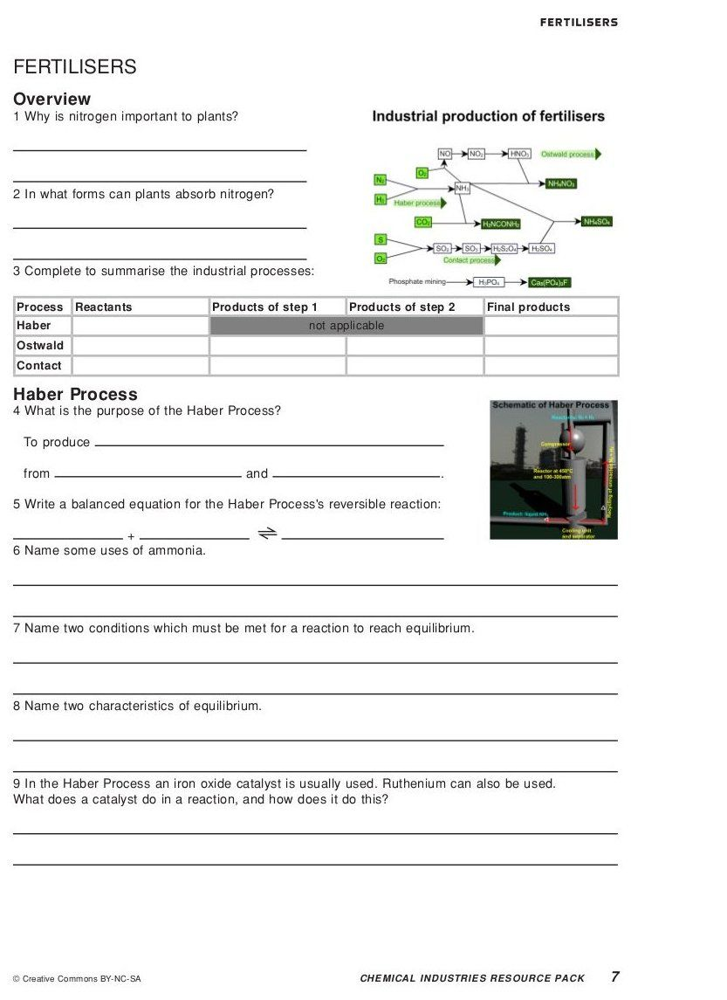

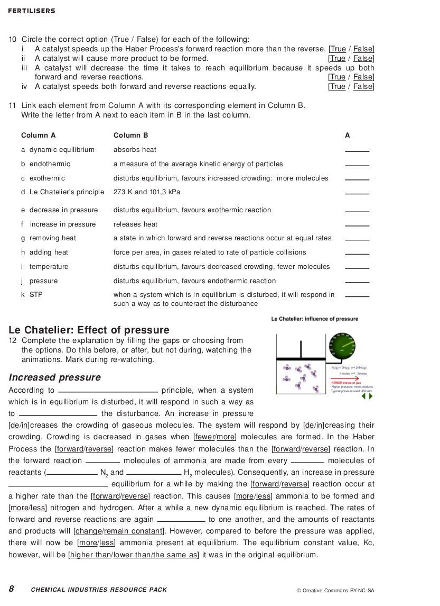

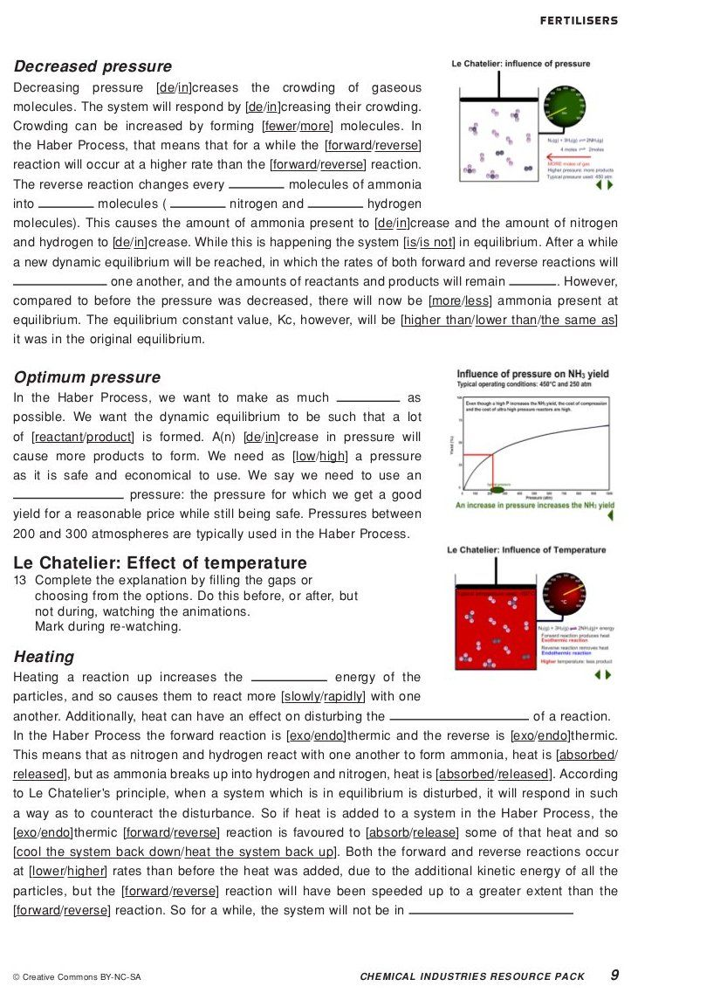

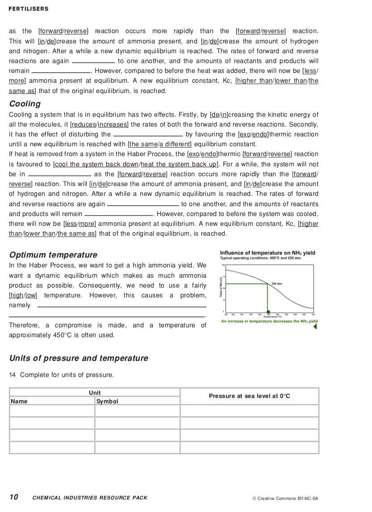

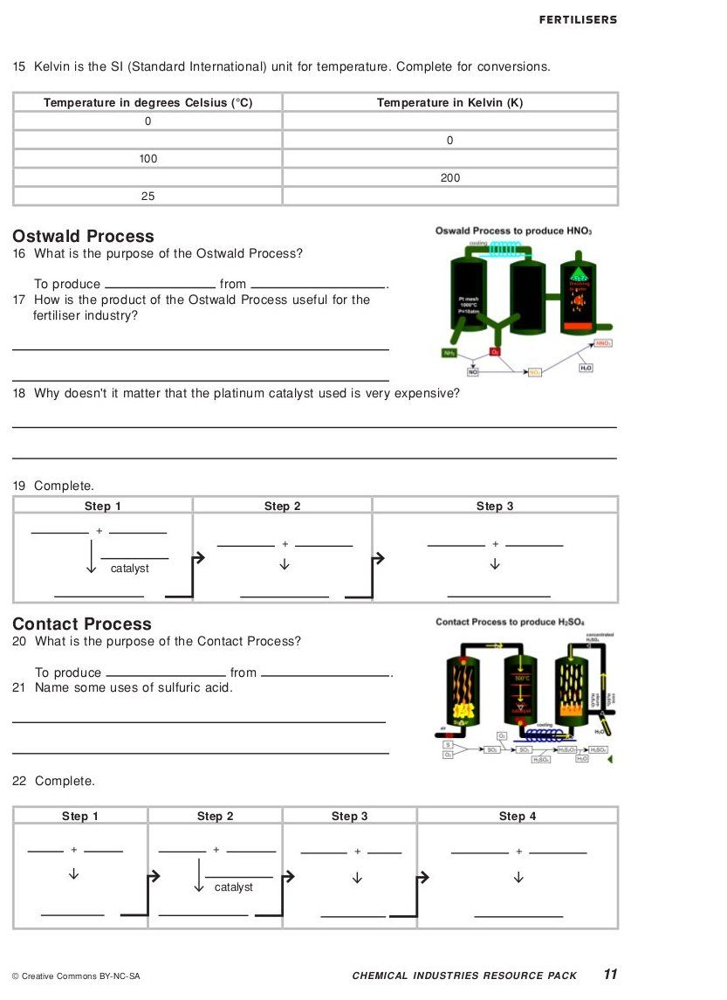

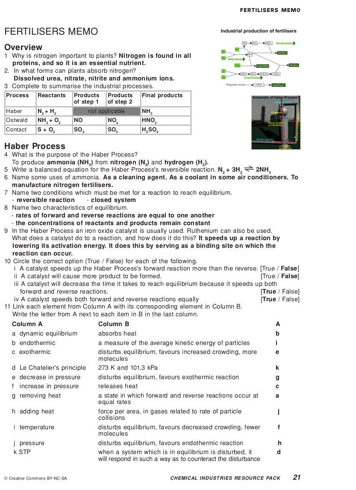

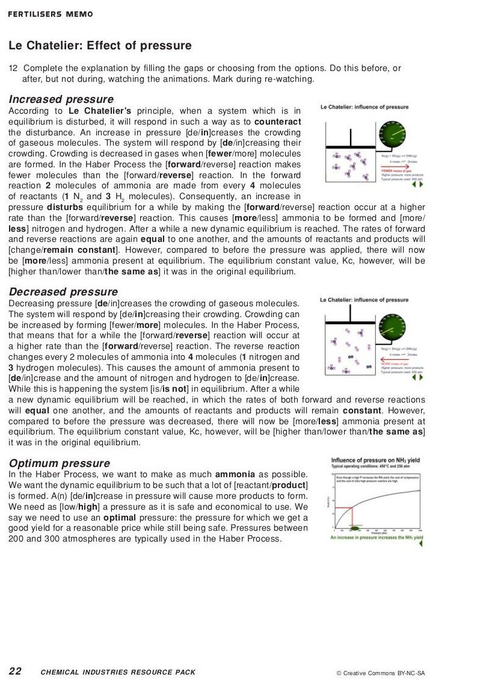

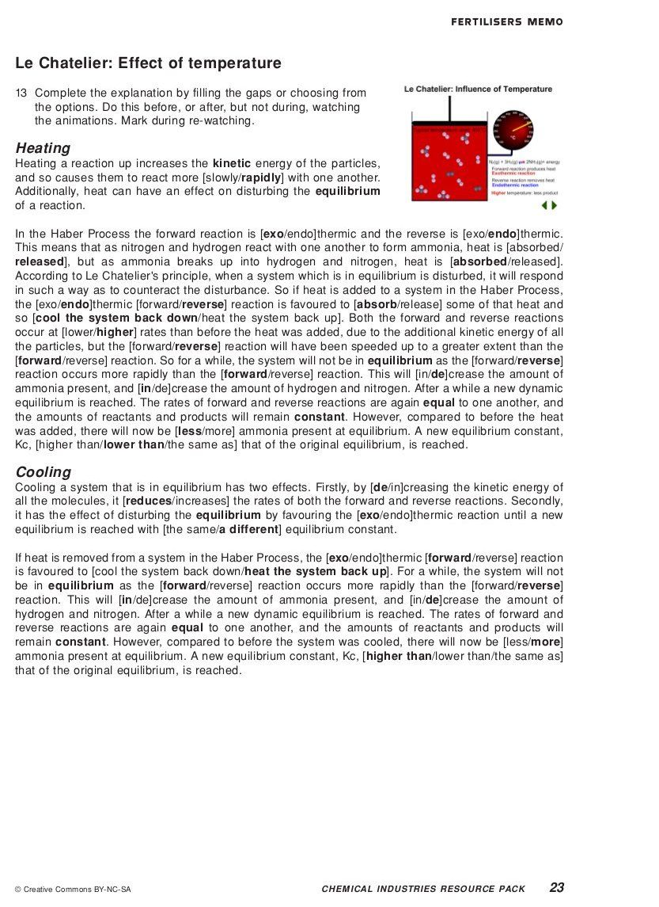

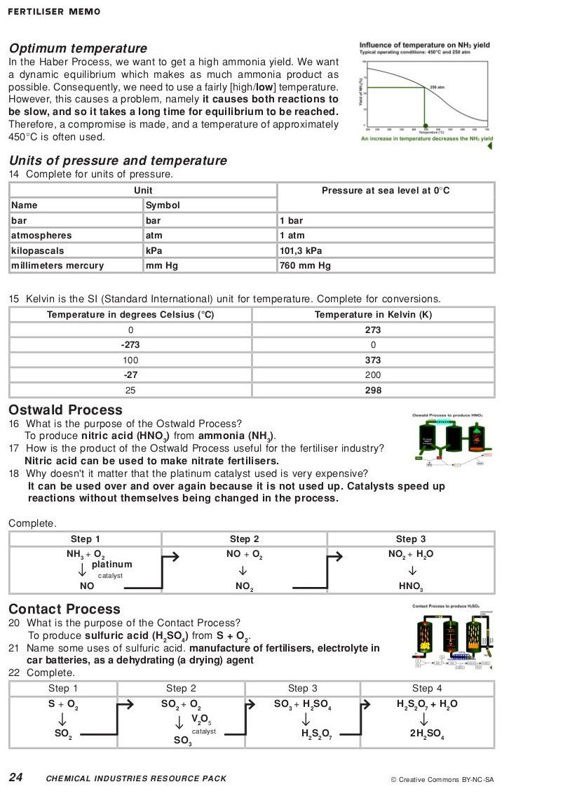

## The industrial production of fertilisers

Now that you have gone through this section, watch the following animation and go through the
                                [worksheet](https://vula.uct.ac.za/access/content/group/9eafe770-4c41-4742-a414-0df36366abe6/Chem%20Ind%20Resource%20Pack/html/teachers-guide/AnimationWorksheets/TG_A_W_F.pdf)
                                that accompanies it.

<Callout type="note" title="Note">
<VideoPlayer src="https://vula.uct.ac.za/access/content/group/9eafe770-4c41-4742-a414-0df36366abe6/Chem%20Ind%20Resource%20Pack/html/animations/Fertilisers.swf" title="Video:
                                                2845" />
</Callout>

Reproductions of the worksheets are given in the teachers guide.

## The industrial production of fertilisers

### Textbook Exercise 14.2

**Problem:**
Use the following processes to create your own mind map of the
                                                        manufacturing of fertilisers:

- Fractional distillation
- Steam reforming
- Haber process
- Contact process
- Ostwald process
- you can, and should, add to this list

Include what the reactants and the products are for each process and
                                                        how these link with the other processes involved.

**Solution:**
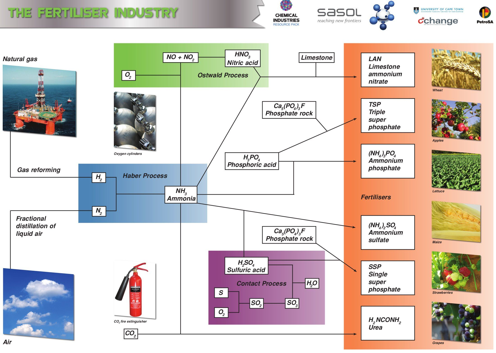

**Problem:**
Research the process of fractional distillation (from old school
                                                        science textbooks, from your teacher, or the internet) and write
                                                        a paragraph on how this process works.

**Solution:**
Fractional distillation is a separation method that uses the
                                                        difference in boiling temperatures of the components of a
                                                        mixture to separate those components. The mixture is heated to
                                                        convert the components into the vapour (gas) phase. The vapour
                                                        mixture is then pumped into a tall separation column (called a
                                                        fractional distillation column), usually at the bottom of the
                                                        column. As the vapour mixture moves up the column and cools, the
                                                        different components (called fractions) condense as the
                                                        temperature drops below the various boiling point temperatures.
                                                        The fractions are collected using collection trays. The
                                                        fractions can be removed from the mixture in this way and thus
                                                        the components are separated. This process is used to separate
                                                        the components of air or crude oil.

The reaction of hydrogen and nitrogen is an exothermic reversible
                                                        reaction.

**Problem:**
Write a balanced equation for this reaction.

**Solution:**
\(\text{N}_{2}(\text{g}) + 3\text{H}_{2}(\text{g})\)
                                                                \(\rightleftharpoons\) \(2\text{NH}_{3}(\text{g})\)

Use your knowledge of chemical equilibrium and explain what
                                                                effect the following will have on this equilibrium
                                                                reaction:

**Problem:**
raising the temperature

**Solution:**
When the **temperature** of any reaction
                                                                        is increased, the rate of both the forward and
                                                                        the reverse reactions will be increased.
                                                                        However, the forward reaction is exothermic.
                                                                        Raising the temperature would favour the
                                                                        reaction which would remove the excess heat. The
                                                                        reverse reaction will therefore be favoured more
                                                                        than the forward reaction. This will result in
                                                                        more \(\text{NH}_{3}\) decomposing to form
                                                                        \(\text{H}_{2}\) and \(\text{N}_{2}\). The
                                                                        overall result will be that **more
                                                                                reactants will be formed**.

**Problem:**
raising the pressure

**Solution:**
Raising the **pressure** will shift the
                                                                        equilibrium to decrease the pressure. This would
                                                                        favour the reaction which produced fewer
                                                                        molecules. The forward reaction produces 2 moles
                                                                        of \(\text{NH}_{3}\) (compared to the 4 moles of
                                                                        the reverse reaction). The forward reaction will
                                                                        therefore be favoured. The overall result will
                                                                        be that **more products will be
                                                                                formed**.

Ammonia and nitric acid react to form the compound A. Compound A is
                                                        soluble in water and can be used as a fertiliser.

**Problem:**
Write down the name and formula for compound A.

**Solution:**
ammonium nitrate, \(\text{NH}_{4}\text{NO}_{3}\)

**Problem:**
What type of reaction takes place to form compound A.

**Solution:**
Acid-base reaction

**Problem:**
Write a balanced equation for the reaction to form compound
                                                                A.

**Solution:**
\(\text{NH}_{3}(\text{g}) + \text{HNO}_{3}(\text{ℓ})\)
                                                                \(\to\) \(\text{NH}_{4}\text{NO}_{3}(\text{s})\)

**Problem:**
Compound A is dissolved in water. Write a balanced ionic
                                                                equation for this dissolution reaction. Include the
                                                                state symbols in your equation.

**Solution:**
\(\text{NH}_{4}\text{NO}_{3}(\text{s})\) \(\to\)
                                                                \(\text{NH}_{4}^{+}(\text{aq}) +
                                                                \text{NO}_{3}^{-}(\text{aq})\)

**Problem:**
Why is it important for fertilisers to be soluble in water?

**Solution:**
So that the plants can absorb them from the soil.

**Problem:**
Compound A can also be used as an explosive. What precautions
                                                                need to be taken when this compound is packaged and
                                                                transported?

**Solution:**
Packages need to be kept away from heat and flames.

The following reaction can be used to manufacture hydrogen gas. It is
                                                        an exothermic redox reaction.

\(\text{CO}(\text{g}) + \text{H}_{2}\text{O}(\text{g})\)
                                                        \(\rightleftharpoons\) \(\text{CO}_{2}(\text{g}) +
                                                        \text{H}_{2}(\text{g})\)

**Problem:**
Write down the reduction half reaction for this reaction.

**Solution:**
Reduction is gain of electrons. \(\text{H}^{+}\) in
                                                                \(\text{H}_{2}\text{O}\) gains an electron to become
                                                                \(\text{H}\).

\(2\text{H}^{+} + 2\text{e}^{-}\) \(\to\) \(\text{H}_{2}\)

**Problem:**
Which compound is the reducing agent?

**Solution:**
Carbon monoxide or \(\text{CO}\). \(\text{CO}\) causes
                                                                \(\text{H}_{2}\text{O}\) to be reduced.

**Problem:**
Which compound is the oxidising agent?

**Solution:**
Water or \(\text{H}_{2}\text{O}\). \(\text{H}_{2}\text{O}\)
                                                                causes \(\text{CO}\) to be oxidised.

**Problem:**
Identify two conditions that will ensure a high yield of
                                                                hydrogen.

**Solution:**
Remove \(\text{CO}_{2}\) and \(\text{H}_{2}\) (the products)
                                                                from the reaction vessel. More product will therefore be
                                                                formed from the same amount of reactants.

Decrease the temperature. This will favour the forward
                                                                (exothermic) reaction and more product will be formed
                                                                with the same amount of reactants, meaning an increased
                                                                yield.

(Increasing the concentration of \(\text{CO}\) or
                                                                \(\text{H}_{2}\text{O}\) (steam) (the reactants) will
                                                                increase the amount of product formed, but not the
                                                                yield. More reactants means that more product must be
                                                                formed to get the same yield because the maximum yield
                                                                possible has increased).
