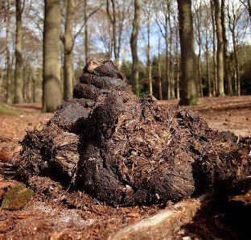
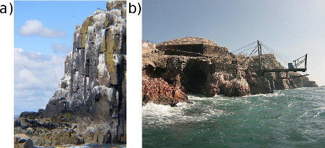
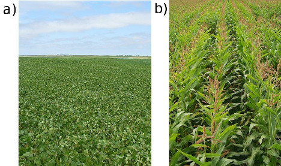
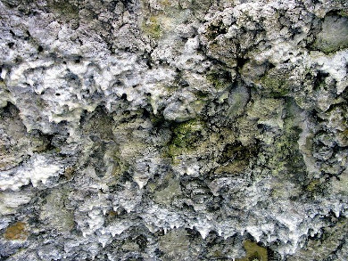
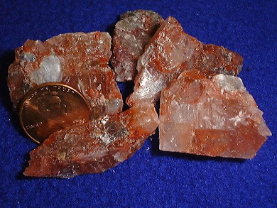

## 14.5 Alternative sources of fertilisers (ESCSJ)

Industrial fertilisers have not always been used, and even today many people prefer to use natural
                        fertilisers rather than man-made ones. For more information on alternative sources of fertiliser
                        see the Chemical Industries Resource Pack worksheets [here](https://vula.uct.ac.za/access/content/group/9eafe770-4c41-4742-a414-0df36366abe6/Chem%20Ind%20Resource%20Pack/html/learner-sheets/F/LS_F3.pdf)
                        and [here](https://vula.uct.ac.za/access/content/group/9eafe770-4c41-4742-a414-0df36366abe6/Chem%20Ind%20Resource%20Pack/html/learner-sheets/F/LS_F9.pdf).

### Organic fertilisers (ESCSK)

Organic fertilisers are not manufactured by man, but come from natural sources. Examples are
                                manure, blood and bones, guano, compost and kelp products. Organic fertilisers contain
                                lower levels of nutrients and might take longer than inorganic fertilisers to be
                                absorbed as they generally have to degrade first. The advantage of organic fertilisers
                                is that they increase the organic component of the soil. This improves the physical
                                structure of the soil, which in turn increases the soil’s water-holding capacity.
                                The nutrients also tend to be released slower than those of inorganic fertilisers,
                                decreasing their contribution to water pollution.

### Manure (ESCSM)

Figure 14.7: Horse dung, a type of manure.

Manure is a solid waste product from animals that is widely used as an organic fertiliser in
                                agriculture. It contains **high levels** of *nitrogen, phosphorus,
                                        potassium* and other nutrients. Manure decomposes over time through
                                bacterial and microbial action and in the process releases these nutrients into the
                                soil. This **slow release mechanism** is a great benefit to farmers as it
                                limits the leaching of nutrients into the ground water, making it available to plants
                                over a longer period of time. Manure also adds organic matter to the soil,
                                *increasing the quality of the soil itself*.

Plants can only absorb nutrients that are dissolved in water. When manure decomposes, the
                                nitrogen compounds are converted to a form that is soluble in water, for example
                                nitrates (\(\text{NO}_{3}^{-}\)). The nitrates are dissolved in the moisture in the soil
                                and plants are then able to absorb the nitrogen compounds through their root system.

Kraal manure

Phosphorus and nitrogen are often the most deficient mineral nutrients in South
                                        African soil. The average NPK formula for kraal manure found in the Eastern Cape
                                        is \(\text{3}\):\(\text{1}\):\(\text{4}\) (3). Unfortunately this is not as high
                                        in phosphorus, and has a much lower nutrient concentration, than many inorganic
                                        fertilisers. However, kraal manure is a much cheaper alternative, is readily
                                        available and does not need to be transported as far.

More information on the use of kraal manure can be found on the Agriculture, Forestry
                                        and Fisheries [website](http://www.nda.agric.za/docs/Infopaks/KraalManure.pdf).

### Guano (ESCSN)

**a)** A cliff covered in guano and **b)** a guano
                                                mine off the coast of Peru. Guano is the excretion of seabirds, bats and
                                                seals.

Guano is the excretion of seabirds, bats and seals. Guano consists of *ammonia, uric acid,
                                        phosphoric acid, oxalic acid* and *carbonic acid* and also has a high
                                concentration of nitrates. The particularly high levels of phosphorus make this an
                                **effective phosphorus fertiliser**. Guano was mined off the West Coast of
                                South Africa as early as 1666. Since the 1840’s, large scale mining of guano
                                caused the reserves to be depleted and mining was stopped by the turn of the century.

### Crop rotation (ESCSP)

**a) ** A soy bean field and **b)** a maize field.
                                                Crop rotation helps to restore nutrients in the soil.

Crop rotation is a farming method that is used to manage the nutrients in soil naturally.
                                When the **same crop** is grown repeatedly in the same place, it eventually
                                **depletes the soil** of specific nutrients. With crop rotation, one type
                                of crop that depletes the soil of a particular kind of nutrient, is rotated with another
                                type of crop which replaces the depleted nutrient. For example, legumes, like beans or
                                peas, have nodules on their roots which contain nitrogen-fixing bacteria. These bacteria
                                help ‘fix’ or change nitrogen into a soluble form. Legumes are therefore
                                often alternated with plants requiring nitrogen, and soy beans can therefore be followed
                                by maize.

### Lime (ESCSQ)

Figure 14.10: Limestone.

Agricultural lime, or crushed limestone, can be used as an alternative fertiliser. Lime
                                **increases the pH of soil**, making the soil less acidic, and **more
                                        soluble** for *nitrogen, potassium* and *phosphorus*
                                compounds. These nutrients will therefore be more readily available for absorption by
                                plants.

### Potash (ESCSR)

Figure 14.11: Potash.

Potash is the **common name** for various mined and manufactured
                                **salts** that contain **potassium** in the water-soluble
                                form. The name is derived from *pot ash*, which was the main method of
                                manufacturing potassium salts before the industrial era. Ashes from a fire were soaked
                                in a pot of water after which the water was filtered out. The water, containing the
                                leached potassium salts, was then evaporated to obtain a white powder known as potash.

Potash is a rich source of potassium and could contain **potassium carbonate**
                                (\(\text{K}_{2}\text{CO}_{3}\)), **potassium chloride** (\(\text{KCl}\)),
                                **potassium sulfate** (\(\text{K}_{2}\text{SO}_{4}\)) or **potassium
                                        nitrate** (\(\text{KNO}_{3}\)). Up to the 19th century potash was
                                manufactured in asheries using wood ashes, but these declined in the late 19th century
                                when large-scale production of potash from mineral salts was established in Germany.

<QuizCard id="s12-14-05a" title="Interactive Exercise 14.10" question="Select one disadvantage of organic fertilisers from the list below." options=[] answer="
                        0
                    " hint="" explanation="Choose the correct option Organic fertilisers come from natural sources. Examples are manure, bones, guano, compost and kelp products. Organic fertilisers contain lower levels of nutrients and might take longer than inorganic fertilisers to be absorbed as they generally have to degrade first. The advantage of organic fertilisers is that they increase the organic component of the soil. This improves the physical structure of the soil, which in turn increases the soil's water-holding capacity. The nutrients also tend to be released slower than those of inorganic fertilisers, decreasing their contribution to water pollution. The correct option is a disadvantage of organic fertilisers is they contain less nutrients . Submit your answer as: they contain less nutrients." />

<QuizCard id="s12-14-05a" title="Interactive Exercise 14.10" question="Select one advantage of organic fertilisers from the list below." options=[] answer="
                        1
                    " hint="" explanation="Choose the correct option Organic fertilisers come from natural sources. Examples are manure, bones, guano, compost and kelp products. Organic fertilisers contain lower levels of nutrients and might take longer than inorganic fertilisers to be absorbed as they generally have to degrade first. The advantage of organic fertilisers is that they increase the organic component of the soil. This improves the physical structure of the soil, which in turn increases the soil's water-holding capacity. The nutrients also tend to be released slower than those of inorganic fertilisers, decreasing their contribution to water pollution. The correct option is an advantage of organic fertilisers is there is less pollution . Submit your answer as: there is less pollution." />

Purpose of the activity:

- To work individually and as a group.
- Testing comprehension skills.
- To summarise the content for study purposes.

This activity involves the learners working on their own for 15 minutes and then forming
                                groups of \(\text{3}\) - \(\text{4}\) to share what they have summarised in the first 15
                                minutes. The collaborative findings of the group are then shared with the class.

Each learner is allocated one of the sub-topics under this heading. The teachers can decide
                                which ones they would like to include. The advantages and disadvantages of fertilisers
                                and the next section on eutrophication could also be included. Ensure that two learners
                                sitting next to each other do not receive the same topic. Give the learners 15 minutes
                                (in silence on their own) to read the content in the textbook and summarise the most
                                important facts in their own words. \(\text{1}\) - \(\text{2}\) sentences will be
                                sufficient. Additional support might be required where learners struggle to identify the
                                most important facts in a paragraph. Now group the learners with the same topics. Each
                                group has 15 minutes to share with each other what they have learned and prepare a
                                summary of their findings (\(\text{3}\) - \(\text{4}\) sentences) which will be reported
                                back to the whole class. If the lesson time at your school is short, the first section
                                of this activity can be given as
                                homework for this lesson so that more class time will be available for feedback. A
                                general discussion of the section can follow.

## Alternative sources of fertilisers

2. Work on your own to summarise one of the sections on the alternative
                                                   fertiliser sources. Remember to summarise in your own words.
4. Find all the other learners in your class who have summarised the same topic
                                                   as you and form a group. Share with your group members what you have
                                                   summarised.
6. As a group, prepare \(\text{3}\) - \(\text{4}\) sentences on your alternative
                                                   source of fertiliser. Share your information with the class in
                                                   \(\text{1}\) - \(\text{2}\) minutes in a debate format.
