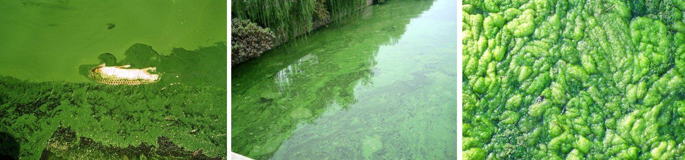

## 14.6 Fertilisers and the environment (ESCSS)

This section can be taught using the suggested class discussion.

The fertiliser industry is a very important industry in South Africa and in the world. It helps
                        provide the nutrients that we need to ensure healthy crops to sustain life on Earth. However,
                        fertilisers can also [harm
                                the environment](https://vula.uct.ac.za/access/content/group/9eafe770-4c41-4742-a414-0df36366abe6/Chem%20Ind%20Resource%20Pack/html/learner-sheets/F/LS_F12.pdf) if they are not used in a responsible manner. This section will
                        focus on some of the environmental problems that excessive use of fertilisers can cause.

### Eutrophication (ESCST)

Eutrophication (Figure 14.12) is
                                the enrichment of an ecosystem with large quantities of chemical compounds, mostly
                                containing the nutrients **nitrogen** and **phosphorus**.
                                Eutrophication is considered a form of **pollution** because it promotes
                                excessive plant growth, favouring certain species over others. In aquatic environments,
                                the rapid growth of certain types of plants can **disrupt the normal functioning
                                        of an ecosystem**, causing a variety of problems. Human society is
                                impacted as well, as health-related problems can occur if eutrophic conditions interfere
                                with the treatment of drinking water. Eutrophication can also decrease the resource
                                value of rivers, lakes, and estuaries.

Figure 14.12: An example of the effect of eutrophication (algal bloom).

Eutrophication
Eutrophication refers to an over-supply in chemical nutrients in an ecosystem,
                                        leading to the depletion of oxygen in a water system through excessive plant
                                        growth. These chemical nutrients usually contain nitrogen or phosphorus.

In some cases, eutrophication can be a natural process that occurs very slowly over time.
                                However, it can also be accelerated by certain human activities. **Agricultural
                                        runoff**, where excess fertilisers are washed off fields and into ground
                                water, and **sewage**, are two of the major causes of eutrophication. The
                                impacts of eutrophication are the following:

- **A decrease in biodiversity (the number of plant and animal species in
                                                          an ecosystem)**
  When a system is enriched with nitrogen, plant growth is accelerated. When
                                                  the number of plants increases in an aquatic system, it can block light
                                                  from reaching deeper water. Plants also consume oxygen for respiration,
                                                  depleting the oxygen content of the water, which can cause other
                                                  organisms, such as fish, to die.
- **Toxicity**
  In certain instances the plants that flourish during eutrophication can be
                                                  toxic and these toxins may accumulate in the food chain.

<Callout type="note" title="Note">
A buffer zone is an area that lies between two other areas, for example, a farm and a
                                        river. It is an area of land designated for environmental protection.
</Callout>

Despite these impacts, there are a number of ways to prevent eutrophication from taking
                                place.

**Prevention of eutrophication:**

- Clean-up measures can directly remove the excess nutrients such as nitrogen
                                                  and phosphorus from the water.
- Creating buffer zones near farms, roads and rivers can also help. These act
                                                  as filters and cause nutrients and sediments to be deposited there
                                                  instead of in the aquatic system.
- Laws relating to the treatment and discharge of sewage can also help to
                                                  control eutrophication.
- A final possible intervention is nitrogen testing and modelling. By assessing
                                                  exactly how much fertiliser is needed by crops and other plants, farmers
                                                  can make sure that they apply only the required amount of fertiliser.
                                                  This means that there is no excess to run off into neighbouring streams
                                                  when it rains. This includes a cost benefit for the farmer as they are
                                                  less likely to waste fertiliser.

<Callout type="note" title="Note">
South Africa's Department of Water Affairs and Forestry has a *National
                                                Eutrophication Monitoring Programme*, which was set up to monitor
                                        eutrophication in impoundments such as dams, where no monitoring was taking
                                        place.
</Callout>

<QuizCard id="s12-14-06a" title="Interactive Exercise 14.11" question="Select the correct word or term for the following definition: An over-supply in chemical nutrients in an ecosystem, leading to the depletion of oxygen in a water system through excessive plant growth." options=["eutrophication", "over population", "fertilisation"] answer="eutrophication" hint="" explanation="Correct answer: eutrophication Submit your answer as: eutrophication" />

<QuizCard id="s12-14-06a" title="Interactive Exercise 14.11" question="The diagram below summarizes the compounds used in the production of some fertilisers. Excess amounts of fertiliser can run down into streams and rivers, leading to eutrophication. Select one negative impact of eutrophication from the list below." options=[] answer="
                        2
                    " hint="" explanation="Choose the correct option Eutrophication refers to an over-supply in chemical nutrients in an ecosystem, leading to the depletion of oxygen in a water system through excessive plant growth. These chemical nutrients usually contain nitrogen or phosphorus. When a system is enriched with nitrogen, plant growth is accelerated. When the number of plants increases in an aquatic system, it can block light from reaching deeper water. Plants also consume oxygen for respiration, depleting the oxygen content of the water, which can cause other organisms, such as fish, to die. In certain instances the plants that flourish during eutrophication can be toxic and these toxins may accumulate in the food chain. The correct option is a negative impact of eutrophication is the plants that benefit from the eutrophication can be toxic . Submit your answer as: the plants that benefit from the eutrophication can be toxic." />

## Dealing with the consequences of eutrophication

In many cases, the damage from eutrophication is already done. As a class, discuss
                                        the following:

2. List all the possible consequences of eutrophication that you can
                                                           think of.
4. Suggest ways to solve the problems that arise because of
                                                           eutrophication.
6. Discuss how the public can help to prevent eutrophication.

- This investigation should be handed out before this section is taught
                                                          so that learners can have their results by the time this section
                                                          is started.
- The last teaching lesson can be spent working on the interpretation
                                                          and recommendations of their findings.
- Teachers can decide in what format they want the investigation handed
                                                          in – a written report, poster, or oral presentation.

## Fertiliser in your area

For this investigation you will be working in a group. Your task is to find out what
                                        fertilisers are used in your area and whether people know about the impact of
                                        fertilisers on the environment, especially the water sources in the area.

2. **Design a survey to find out the following:**
   - Do people use fertilisers in their gardens or the
                                                                             areas around their homes?
   - What type of fertilisers are they using?
   - Why are they using fertilisers?
   - How often do they apply fertilisers?
   - How much fertiliser do they use in each application?
   - Do they use organic or inorganic fertilisers?
   - Which ones do they think are better to use?
   - How do they think fertilisers influence the quality
                                                                             of water in the area?
4. **Collect your data**
   Take the survey to at least \(\text{10}\) people in your area. Record
                                                           their responses.
6. **Present your findings**
   Present your findings in tables or graphs and write a one-page
                                                           summary of what you have found.
8. **Interpret your findings**
   Discuss your findings:
   - Answer all the questions that were posed in the
                                                                             beginning of the investigation.
   - Did you find what you thought you would?
   - What was different?
   - What was the same?
   - Why do you think this is the case?
10. **Make recommendations**
   Include some recommendations to people in your neighbourhood
                                                           regarding the use of fertilisers and their impact on the
                                                           environment.
   Suggestion: Report your findings in your local newspaper to promote
                                                           awareness.
