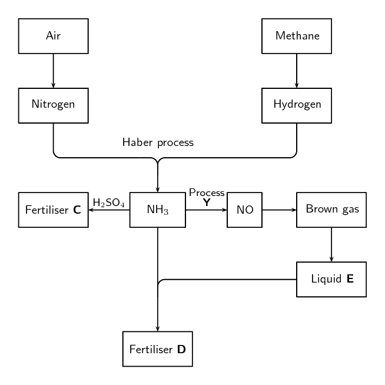
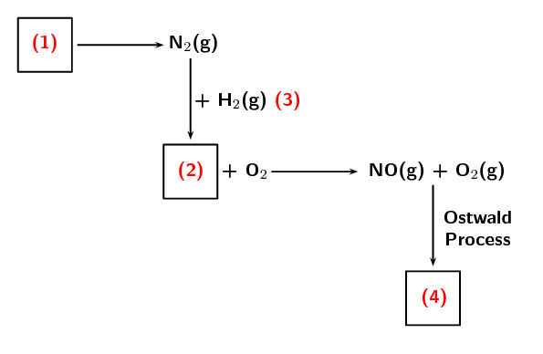

### Textbook Exercise 14.3

**Problem:**
The following extract comes from an article on fertilisers:

*A world without food for its people and a world with an environment
                                                        poisoned through the actions of man are two contributing factors
                                                        towards a disaster scenario.*

Do you agree with this statement? Write down at least three arguments to
                                                substantiate your answer.

**Solution:**
Learners give their own opinion.

There is likely to be a gap between food production and demand in several
                                                parts of the world by 2020. Demand is influenced by population growth
                                                and urbanisation, as well as income levels and changes in dietary
                                                preferences. While there is an increasing world population to feed, most
                                                soils in the world used for large-scale, intensive production of crops
                                                lack the necessary nutrients for the crops. This is where fertilisers
                                                can play a role.

The flow diagram below shows the main steps in the industrial preparation of
                                                two important solid fertilisers.

**Problem:**
How can fertilisers play a role in increasing the soil’s
                                                        ability to produce crops?

**Solution:**
Fertilisers supply nutrients to the soil in a soluble form which
                                                        plants can then absorb.

**Problem:**
Are the processes illustrated by the flow diagram above that of
                                                        organic or inorganic fertilisers? Give a reason for your answer.

**Solution:**
Inorganic fertilisers. Industrial processes are involved in the
                                                        formation of these fertilisers, and they did not come from
                                                        natural sources or living organisms.

**Problem:**
Write down the balanced chemical equation for the formation of the
                                                        brown gas.

**Solution:**
\(2\text{NO}(\text{g}) + \text{O}_{2}(\text{g})\)
                                                        \(\rightleftharpoons\) \(2\text{NO}_{2}(\text{g})\)

**Problem:**
Write down the name of process **Y**.

**Solution:**
Ostwald process

**Problem:**
Write down the chemical formula of liquid **E**.

**Solution:**
\(\text{HNO}_{3}\)

**Problem:**
Write down the chemical formulae of fertilisers **C**
                                                        and **D** respectively.

**Solution:**
**C** - \((\text{NH}_{4})_{2}\text{SO}_{4}\)

**D** - \(\text{NH}_{4}\text{NO}_{3}\)

The production of nitric acid is very important in the manufacture of
                                                fertilisers. Look at the diagram below, which shows part of the
                                                fertiliser production process, and then answer the questions that
                                                follow.

**Problem:**
Name the process at (1).

**Solution:**
Fractional distillation of air

**Problem:**
Name the gas at (2).

**Solution:**
Ammonia

**Problem:**
Name the process at (3) that produces gas (2).

**Solution:**
Haber process

**Problem:**
Name the immediate product at (4).

**Solution:**
nitrogen dioxide

**Problem:**
Name the final product of the Ostwald process (product (4) +
                                                        \(\text{H}_{2}\text{O}\)).

**Solution:**
nitric acid

**Problem:**
Name two fertilisers that can be produced from nitric acid.

**Solution:**
Nitrophosphates or ammonium nitrate.
